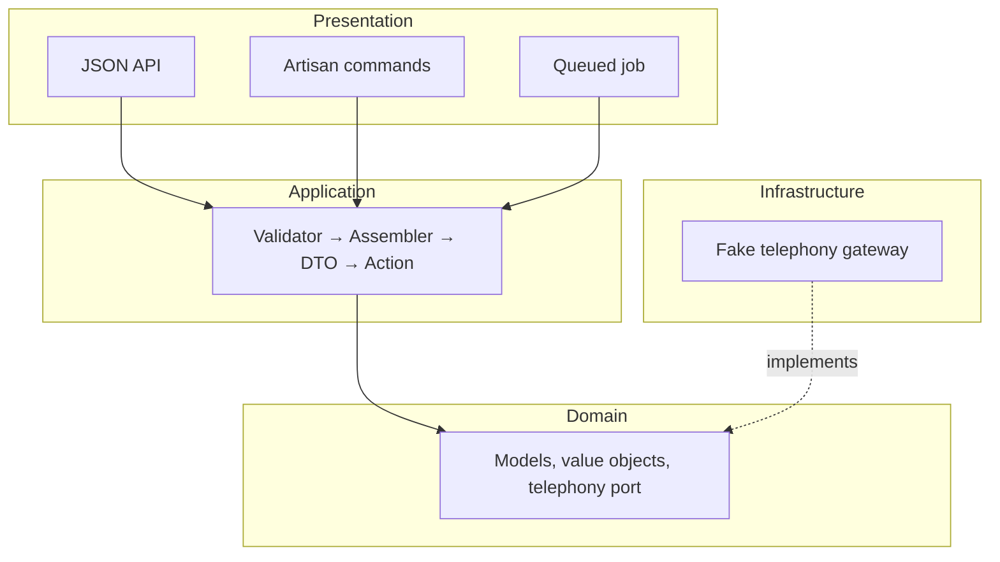

# Rex CRM: Contacts module

A Contacts module for a Laravel 13 modular monolith, with a React + TypeScript SPA on top. You can upsert, read, search, delete and call contacts through a JSON API, Artisan commands or a queued job. Calls go to a mocked telephony provider.

## How I used AI

Claude Code wrote most of the code. I spent my time on decisions and review, with these tools doing the rest:

- **Superpowers**, a Claude Code plugin, took each part from brainstorm to spec to plan (in `docs/superpowers/`). Claude then built it in reviewed waves, with a final review on the most capable model.
- **Laravel Boost**, an MCP server, gave it docs for the installed package versions and read access to the database schema.

So the outcome doesn't depend on trusting the AI, a committed setup in `.claude/` keeps it in line:

- **Hooks** block destructive commands, enforce the commit format and lint every edit.
- **Rules** teach it this architecture.
- **Skills** review each commit (DRY, SOLID, OWASP, database performance), write PR descriptions, and scale the process to the size of the task.

Pest, Vitest, Pint, ESLint and `tsc` then check the result.

## Concessions and next steps

- **Models live in Domain**, a pragmatic choice rather than strict DDD.
- **Session auth only.** There are no API tokens or per-team permissions.
- **Calls are mocked**, and there's no call history.
- **Only calling is queued.** `CallContactJob` wraps the same Action the API uses, so upsert or delete could be queued the same way when a use case needs it.
- **No concurrency test.** Upserts take real row locks, but no test runs two at once.
- **Search has no totals.** Cursor paging gives Previous and Next but no page count. A very broad term is capped at 2 s and returns a 422 `search_too_broad`.
- **The index migration blocks writes** on `contacts` while it runs, so a large table needs a maintenance window or pt-online-schema-change.

With more time I'd add:

- CI that runs linting and the tests;
- parallel testing;
- more of the Claude setup in `.claude/`;
- an external API with token auth;
- team-level authorisation;
- a real telephony adapter;
- route-level code splitting in the SPA;
- smaller, stacked PRs instead of one large one, so each is easier to review.

## Running it

You need PHP 8.5 (with `redis`), Node 22, pnpm 11, MySQL 8 and Redis, plus `jq` for the Claude hooks. MySQL needs a `rex_code_challenge` database and a `rex_code_challenge_testing` one, and must run with `innodb_ft_enable_stopword=OFF`.

```bash
composer install && pnpm install --frozen-lockfile
cp .env.example .env && php artisan key:generate   # set DB_* for your MySQL
php artisan migrate --seed
pnpm run build   # or: composer run dev
```

Sign in as **demo@example.com / password**. The seeder adds 10,000 contacts, so search and paging run on realistic volume. `php artisan contacts:check-search-indexes` checks the MySQL setup.

- **API contract:** `app/Modules/Contacts/Presentation/Http/openapi.json`
- **CLI:** `php artisan contacts:{upsert,show,search,delete,call}`
- **Tests:** `php artisan test` and `pnpm test`

## Architecture

Each box is a folder in `app/Modules/Contacts/`, and every arrow points inward:



Each choice answers a point in the brief:

- **Teams of 4–5 per repo → enforced layers.** Pest architecture tests fail the build when an import points against the arrows, so the boundaries hold without anyone policing them in review.
- **Sync, async, CLI and HTTP → one Action per use case.** The API, CLI and queued job all go through validator → assembler → DTO → Action, so every entry point applies the same rules.
- **Several resources per request → transactional writes.** Each upsert saves the contact, its emails and its phones in one locked transaction. `POST` create and call require an `Idempotency-Key`, so a retry can't duplicate anything.
- **Tested business rules → value objects.** `PhoneNumber` (E.164, AU or NZ only) and `EmailAddress` own their rules, and the tests sit next to the code they test.
- **Third-party API consumers → a strict contract.** Errors are RFC 9457 problem details with stable codes and field-level messages. The OpenAPI contract is tested against the routes, and the SPA's types are generated from it.
- **Large-scale CRUD → indexed search and a modular SPA.** Name and phone use FULLTEXT `ngram` indexes, email domain a prefix index, and tests check the `EXPLAIN` output. The SPA (React 19, TanStack Query, shadcn/ui) is organised by module like the backend, and keeps search in the URL.
