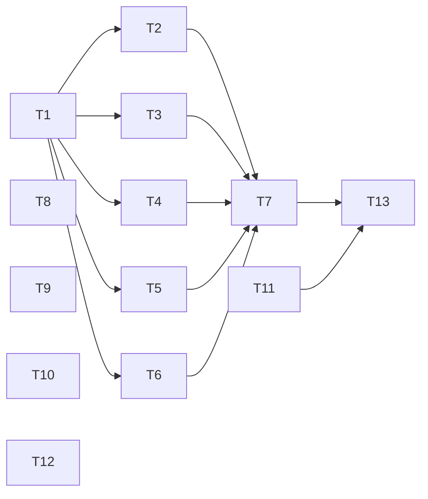

# Claude Code Setup Implementation Plan

> **For agentic workers:** REQUIRED SUB-SKILL: Use superpowers:subagent-driven-development (recommended) or superpowers:executing-plans to implement this plan task-by-task. Steps use checkbox (`- [ ]`) syntax for tracking.

**Goal:** Commit a Claude Code setup to this repo (guard and lint hooks, rules, a `/feature` skill, review skills), switch it to pnpm with supply-chain hardening, and make Pest find tests colocated with the code.

**Architecture:**
- **Hooks:** small single-purpose bash + jq scripts in `.claude/hooks/`. They share `lib/hook.sh` (read input, split a command into its parts, deny or ask) and `lib/testing.sh` (fixtures and assertions). Each hook has a `*.test.sh` next to it, and `run-tests.sh` runs them all.
- **Settings:** `.claude/settings.json` registers the hooks. The rules and skills are plain markdown.
- **pnpm and Pest:** settings live in `pnpm-workspace.yaml` and `phpunit.xml` / `tests/Pest.php`.

**Tech Stack:** Claude Code 2.1.x hooks, rules and skills; bash; jq 1.7; pnpm 11.1.2; Laravel 13 / PHP 8.5; Pest 5.3.

**Spec:** `docs/superpowers/specs/2026-11-01-claude-setup-design.md`

## Global Constraints

**Git**
- Branch: `REX-0001`. Every commit subject is `REX-0001: <description>`, ending with the trailer `Co-Authored-By: Claude Opus 5.5 <noreply@anthropic.com>`.
- Never stage Rob's Lerd files: `.lerd.yaml`, `.node-version`, `.php-version`, and the `.gitignore` change. Stage explicit paths only, never `git add -A` or `git add .`.

**Commands**
- Never run recursive `rm` in any form. Remove tracked files with `git rm`, single untracked files with `rm <file>`, and empty directories with `rmdir`.
- pnpm only. Never `npm`, `npx` or `yarn`.
- Once Task 7 lands, the guards treat every line and every quoted string in a command as its own command. Commit messages and `echo` text must not contain a line or quoted string that starts with `rm -r`, `npm`, `npx`, `yarn`, `git clean`, and so on.

**Scope**
- No new Composer or pnpm dependencies.
- Hooks use bash and jq only.
- Don't edit `CLAUDE.md`, `AGENTS.md`, or the Boost-installed skills (`laravel-best-practices`, `testing-best-practices`, `tailwindcss-development`, `infer-conventions`, `deploying-to-cloud`).
- No committed file mentions Paradev or Superset.

**PHP**
- After PHP edits, run `vendor/bin/pint --dirty --format agent`.

**Exact values from the spec**
- `minimumReleaseAge: 10080` (7 days, in minutes)
- `trustPolicy: no-downgrade`
- `packageManager: "pnpm@11.1.2"`
- Superpowers plugin id: `superpowers@claude-plugins-official`

## Review Focus

These are failure modes the spec implies but no task's main tests exercise, most likely first. Each one has a pinning test in the task named in brackets.

1. **Malformed hook input.** A guard hook given non-JSON stdin must block (exit 2), not let the command through. [Task 1]
2. **A hook registered in `settings.json` is missing or not executable.** Claude Code would skip it silently. A test must fail when any registered command path is missing or not executable. [Task 7]
3. **Commit on a detached HEAD**, where there's no branch name to use as the prefix. Expect a deny that explains it, not a crash or an allow. [Task 5]
4. **A file path containing spaces** in the lint hooks. Expect it to be linted normally. [Task 6]
5. **The architecture test passing only because no modules exist yet.** Expect it to fail once a module's Domain uses its Presentation layer. [Task 12, proved with a temporary probe module]

---

## Dependency Tree

| ID | Task | Depends on | Touches | Wave |
|---|---|---|---|---|
| T1 | Hook library and test harness | none | `.claude/hooks/lib/*`, `.claude/hooks/run-tests.sh` | 1 |
| T8 | Project rules | none | `.claude/rules/*` | 1 |
| T9 | Review skills | none | `.claude/skills/review-*/` | 1 |
| T10 | `/feature` skill | none (review skill names fixed below) | `.claude/skills/feature/` | 1 |
| T11 | pnpm switch and hardening | none | `package.json`, `package-lock.json`, `pnpm-lock.yaml`, `pnpm-workspace.yaml`, `.npmrc`, `composer.json` | 1 |
| T12 | Colocated tests | none | `phpunit.xml`, `tests/**` | 1 |
| T2 | `guard-destructive` hook | T1 | `.claude/hooks/guard-destructive.*` | 2 |
| T3 | `enforce-pnpm` hook | T1 | `.claude/hooks/enforce-pnpm.*` | 2 |
| T4 | `ask-dependency-change` hook | T1 | `.claude/hooks/ask-dependency-change.*` | 2 |
| T5 | `commit-format` hook | T1 | `.claude/hooks/commit-format.*` | 2 |
| T6 | Lint hooks | T1 | `.claude/hooks/lint-php.*`, `.claude/hooks/lint-frontend.*` | 2 |
| T7 | Register hooks and permissions | T2–T6 | `.claude/settings.json`, `.claude/settings.test.sh` | 3 |
| T13 | Require approval to edit guard files | T7, T11 | `.claude/settings.json`, `.claude/settings.test.sh` | 4 |



No two tasks in the same wave touch the same files. For sequential execution, run the tasks in numeric order (T1 → T13). The hooks become active as soon as Task 7 changes `settings.json`, because Claude Code reloads settings, so every task after it runs under the guards.

---

### Task 1: Hook library and test harness

**Files:**
- Create: `.claude/hooks/lib/hook.sh`
- Create: `.claude/hooks/lib/testing.sh`
- Create: `.claude/hooks/run-tests.sh` (executable)
- Test: `.claude/hooks/lib/hook.test.sh`

**Interfaces:**

Produces, in `lib/hook.sh` (sourced by every hook):
- `hook_read_input`: reads stdin into the global `HOOK_INPUT`. If stdin isn't valid JSON, it writes `Hook input was not valid JSON; blocking to be safe.` to stderr and exits 2.
- `hook_field <jq-filter>`: prints `jq -r '<filter> // empty'` of `HOOK_INPUT`.
- `hook_deny <reason>` and `hook_ask <reason>`: print `{"hookSpecificOutput":{"hookEventName":"PreToolUse","permissionDecision":"deny"|"ask","permissionDecisionReason":<reason>}}` (built with `jq -n --arg`), then `exit 0`.
- `command_segments <command>`: prints one normalised simple command per line.
  - **Splits on** `&&`, `||`, `;`, `|`, `&`, newlines, `$(`, backticks, `(`, `)`, `{`, `}`, and both quote characters. This means `bash -c "…"`, `echo "$(…)"` and heredoc bodies all get checked.
  - **Trims** whitespace and drops empty segments.
  - **Strips leading wrappers**, repeatedly: `sudo`, `env`, `command`, `exec`, `nohup`, `time`, `nice`, `xargs`, together with their `-flag` tokens, plus `NAME=value` assignments.
  - **Normalises the program name** to its basename, with any leading `\` removed (`/bin/rm` → `rm`).

Produces, in `lib/testing.sh` (sourced by every `*.test.sh`):
- **Paths:**
  - `HOOKS_DIR`: absolute path to `.claude/hooks`.
  - `HOOK_TEST_DIR`: `${TMPDIR:-/tmp}/claude-hook-tests`. Created with `mkdir -p`, reused between runs, and never deleted.
- **Fixture builders:**
  - `bash_input <command> [cwd]`: prints `{"hook_event_name":"PreToolUse","tool_name":"Bash","tool_input":{"command":…},"cwd":…}`. `cwd` defaults to the repo root.
  - `edit_input <tool-name> <file-path> [event]`: prints the same shape with `tool_input.file_path`. `event` defaults to `PreToolUse`.
- **Running hooks and asserting:**
  - `run_hook <script-name> <json>`: runs `$HOOKS_DIR/<script-name>` with the JSON on stdin, and sets `HOOK_STDOUT`, `HOOK_STDERR` and `HOOK_EXIT`.
  - `expect_decision <label> <script-name> <json> <deny|ask|allow>`:
    - `allow` means empty stdout and exit 0;
    - `deny` and `ask` mean exit 0 and a matching `.hookSpecificOutput.permissionDecision`.
  - `expect_equals <label> <expected> <actual>` and `expect_contains <label> <needle> <haystack>`.
  - `finish_tests`: prints `<n> passed, <m> failed` and exits 1 if any test failed.

Produces `run-tests.sh`: runs every `*.test.sh` under `.claude/` with bash, prints each file's summary, and exits non-zero if any file fails.

- [ ] **Step 1: Write `lib/hook.test.sh`** covering `command_segments` and `hook_read_input`. Each row is the input, then the segments expected among the output:

```
'a && b'                    → 'a', 'b'
'a; b | c'                  → 'a', 'b', 'c'
$'a\nb'                     → 'a', 'b'
'cd x && sudo rm -rf y'     → 'rm -rf y'
"bash -c 'rm -rf y'"        → 'rm -rf y'
'echo "$(rm -rf y)"'        → 'rm -rf y'
'echo `rm -rf y`'           → 'rm -rf y'
'/bin/rm -rf y'             → 'rm -rf y'
'\rm -rf y'                 → 'rm -rf y'
'env FOO=1 npm install'     → 'npm install'
'FOO=1 npx tsc'             → 'npx tsc'
'find . | xargs -0 rm -rf'  → 'rm -rf'
```

Also test that `hook_read_input` given `not json` exits 2 with the stderr message above. This pins Review Focus 1.

- [ ] **Step 2: Run it and check it fails.** Run `bash .claude/hooks/lib/hook.test.sh`. Expected: it fails, because `lib/hook.sh` doesn't exist yet.

- [ ] **Step 3: Implement `lib/hook.sh` and `lib/testing.sh`** to the interfaces above, plus `run-tests.sh`. Start every script with `set -euo pipefail`. `lib/hook.sh` checks that `jq` is on the PATH; if it isn't, it writes `jq is required by Claude hooks` to stderr and exits 2.

- [ ] **Step 4: Run the tests and check they pass.** Run `.claude/hooks/run-tests.sh`. Expected: `hook.test.sh` reports `0 failed`, and the script exits 0.

- [ ] **Step 5: Commit**

```bash
chmod +x .claude/hooks/run-tests.sh
git add .claude/hooks/lib .claude/hooks/run-tests.sh
git commit -m "REX-0001: hook library and test harness" -m "Co-Authored-By: Claude Opus 5.5 <noreply@anthropic.com>"
```

---

### Task 2: `guard-destructive` hook

**Files:**
- Create: `.claude/hooks/guard-destructive.sh` (executable)
- Test: `.claude/hooks/guard-destructive.test.sh`

**Interfaces:**
- Consumes: `hook_read_input`, `hook_field`, `hook_deny` and `command_segments` from Task 1.
- Produces: the executable `guard-destructive.sh`, for the PreToolUse `Bash` hook. It denies with a reason, or prints nothing.

- [ ] **Step 1: Write `guard-destructive.test.sh`**, using `expect_decision … "$(bash_input '<cmd>')" deny|allow` for each command below.

**Must deny:**
- `rm`:
  - `rm -rf dir`
  - `rm -fr dir`
  - `rm -Rf dir`
  - `rm -r -f dir`
  - `rm -r dir`
  - `rm -R dir`
  - `rm --recursive dir`
  - `rm -rfv dir`
  - `cd app && rm -rf vendor`
  - `bash -c 'rm -rf x'`
  - `/bin/rm -rf x`
  - `echo "rm -rf x"` (the documented conservative case)
- `find`:
  - `find . -name '*.log' -delete`
  - `find . -type f -exec rm {} \;`
- `git clean`:
  - `git clean -f`
  - `git clean -fd`
  - `git clean -xdf`
- `git reset`:
  - `git reset --hard`
  - `git reset --hard HEAD~1`
- force-push:
  - `git push --force`
  - `git push -f origin main`
  - `git push origin +main`
  - `git push --force-with-lease`
- stash and branch deletion:
  - `git stash drop`
  - `git stash clear`
  - `git branch -D feature`
  - `git branch --delete --force feature`
- discarding file changes:
  - `git checkout -- app/Foo.php`
  - `git checkout .`
  - `git restore app/Foo.php`
  - `git restore .`
- database:
  - `php artisan db:wipe`
  - `php artisan migrate:fresh`
  - `php artisan migrate:fresh --seed`
  - `php artisan migrate:reset`

**Must allow:**
- files:
  - `rm file.txt`
  - `rm -f file.txt`
  - `rmdir empty`
  - `find . -name '*.php'`
- `git rm`:
  - `git rm app/Foo.php`
  - `git rm -r --cached dir`
- `git clean` dry run:
  - `git clean -n`
- `git reset`:
  - `git reset HEAD app/Foo.php`
  - `git reset --soft HEAD~1`
- `git push`:
  - `git push`
  - `git push origin REX-0001`
- `git stash`:
  - `git stash`
  - `git stash pop`
  - `git stash list`
- `git branch`:
  - `git branch -d merged`
- `git checkout`, `git switch` and `git restore`:
  - `git checkout main`
  - `git checkout -b new`
  - `git switch main`
  - `git restore --staged app/Foo.php`
- database:
  - `php artisan migrate`
  - `php artisan migrate:status`
- other:
  - `pnpm install`
  - `ls -la`

Also: an input with no `tool_input.command` → allow.

**Reasons:** every deny reason must contain one of `git rm`, `delete a single named file`, or `ask the user`.

- [ ] **Step 2: Run it and check it fails.** Run `bash .claude/hooks/guard-destructive.test.sh`. Expected: the deny cases fail, because the hook doesn't exist yet.

- [ ] **Step 3: Implement `guard-destructive.sh`.** Read the input, then check each line of `command_segments "$(hook_field .tool_input.command)"` against these categories:
  - recursive `rm`: any token that matches `-[a-zA-Z]*[rR]` or is `--recursive`
  - `find` with `-delete` or with `-exec rm`
  - `git clean` with a short-flag token (`-x…`) containing `f`, or with `--force`
  - `git reset --hard`
  - `git push` with a token `--force*`, `-f`, or a refspec starting with `+`
  - `git stash drop` / `git stash clear`
  - `git branch` with `-D`, or with both `--delete` and `--force`
  - `git checkout` with a `--` token or a `.` argument
  - `git restore` without `--staged`, or with `--worktree` / `-W`
  - `artisan` with `db:wipe`, `migrate:fresh` or `migrate:reset`

  On the first match, `hook_deny` with a category-specific reason.

- [ ] **Step 4: Run the tests and check they pass.** Run `.claude/hooks/run-tests.sh`. Expected: `0 failed`, exit 0.

- [ ] **Step 5: Commit**

```bash
chmod +x .claude/hooks/guard-destructive.sh
git add .claude/hooks/guard-destructive.sh .claude/hooks/guard-destructive.test.sh
git commit -m "REX-0001: guard against destructive commands" -m "Co-Authored-By: Claude Opus 5.5 <noreply@anthropic.com>"
```

---

### Task 3: `enforce-pnpm` hook

**Files:**
- Create: `.claude/hooks/enforce-pnpm.sh` (executable)
- Test: `.claude/hooks/enforce-pnpm.test.sh`

**Interfaces:**
- Consumes: the Task 1 library.
- Produces: the executable `enforce-pnpm.sh`, for the PreToolUse `Bash` hook.

- [ ] **Step 1: Write `enforce-pnpm.test.sh`** with these cases.

**Must deny:**
- `npm install`
- `npm run build`
- `npx vite`
- `yarn add react`
- `cd x && npm ci`
- `/usr/local/bin/npm test`
- `FOO=1 npx tsc`

**Must allow:**
- `pnpm install`
- `pnpm exec vite`
- `pnpm dlx shadcn`
- `pnpm run build`
- `echo done`
- `git commit -m "REX-0001: switch to pnpm"`

**Reasons:** the deny reason contains `pnpm`, and for `npx` it also contains `pnpm dlx`.

- [ ] **Step 2: Run it and check it fails.** Run `bash .claude/hooks/enforce-pnpm.test.sh`. Expected: the deny cases fail.

- [ ] **Step 3: Implement `enforce-pnpm.sh`.** Deny when the program of any segment is `npm`, `npx` or `yarn`. The reason maps:
  - `npm` → `pnpm`
  - `npx` → `pnpm exec` (installed binaries) or `pnpm dlx` (one-off packages)
  - `yarn` → `pnpm`

- [ ] **Step 4: Run the tests and check they pass.** Run `.claude/hooks/run-tests.sh`. Expected: `0 failed`, exit 0.

- [ ] **Step 5: Commit** `.claude/hooks/enforce-pnpm.sh` and `.claude/hooks/enforce-pnpm.test.sh` (after `chmod +x .claude/hooks/enforce-pnpm.sh`), with the message `REX-0001: enforce pnpm`.

---

### Task 4: `ask-dependency-change` hook

**Files:**
- Create: `.claude/hooks/ask-dependency-change.sh` (executable)
- Test: `.claude/hooks/ask-dependency-change.test.sh`

**Interfaces:**
- Consumes: the Task 1 library, including `hook_ask`.
- Produces: the executable `ask-dependency-change.sh`, for the PreToolUse hooks on `Bash` and on `Edit|Write|MultiEdit`. It returns `ask`, or prints nothing.

- [ ] **Step 1: Write `ask-dependency-change.test.sh`** with these cases.

**Must ask (Bash):**
- `pnpm add`:
  - `pnpm add react`
  - `pnpm add -D vitest`
  - `cd x && pnpm add y`
- `pnpm install` with a package name:
  - `pnpm install react`
  - `pnpm i react`
  - `pnpm install -D vitest`
- `pnpm update`:
  - `pnpm update`
  - `pnpm up`
  - `pnpm update react`
- `pnpm remove`:
  - `pnpm remove react`
  - `pnpm rm react`
  - `pnpm uninstall react`
  - `pnpm un react`
- `pnpm dlx`:
  - `pnpm dlx shadcn@latest init`
- `pnpm approve-builds`:
  - `pnpm approve-builds`
- `composer require`:
  - `composer require laravel/sanctum`
  - `composer require --dev foo/bar`
- `composer remove`:
  - `composer remove foo/bar`
- `composer update`:
  - `composer update`
  - `composer update laravel/framework`

**Must ask (file edits):**
- `edit_input Edit /repo/package.json`
- `edit_input Write /repo/composer.json`
- `edit_input Edit /repo/packages/x/package.json`

**Must allow:**
- `pnpm install`
- `pnpm i`
- `pnpm install --frozen-lockfile`
- `pnpm run build`
- `pnpm import`
- `composer install`
- `composer show`
- `composer dump-autoload -o`
- `edit_input Edit /repo/app/Foo.php`
- `edit_input Edit /repo/package-lock.json`
- `edit_input Edit /repo/package.json.bak`

**Reasons:**
- For commands, the reason names the matched segment and mentions `minimumReleaseAge`.
- For file edits, the reason names the file.

- [ ] **Step 2: Run it and check it fails.** Run `bash .claude/hooks/ask-dependency-change.test.sh`. Expected: the ask cases fail.

- [ ] **Step 3: Implement `ask-dependency-change.sh`.**
  - **For `tool_name == "Bash"`**, check each segment:
    - `pnpm` with the subcommand `add`, `update`/`up`/`upgrade`, `remove`/`rm`/`uninstall`/`un`, `dlx` or `approve-builds` → ask.
    - `pnpm` with `install`/`i` → ask only if a non-flag argument follows.
    - `composer` with the subcommand `require`/`req`, `remove`/`rm` or `update`/`upgrade`/`u` → ask.
  - **Otherwise**, take the basename of `tool_input.file_path`. If it is exactly `package.json` or `composer.json` → ask.

- [ ] **Step 4: Run the tests and check they pass.** Run `.claude/hooks/run-tests.sh`. Expected: `0 failed`, exit 0.

- [ ] **Step 5: Commit** both files (after `chmod +x`), with the message `REX-0001: ask before dependency changes`.

---

### Task 5: `commit-format` hook

**Files:**
- Create: `.claude/hooks/commit-format.sh` (executable)
- Test: `.claude/hooks/commit-format.test.sh`

**Interfaces:**
- Consumes: the Task 1 library.
- Produces: the executable `commit-format.sh`, for the PreToolUse `Bash` hook. It reads the branch with `git -C "<cwd>" branch --show-current`, where `<cwd>` is the input's `.cwd`, falling back to `$CLAUDE_PROJECT_DIR`.

- [ ] **Step 1: Write `commit-format.test.sh`.**

**Fixture repos** under `$HOOK_TEST_DIR`, created idempotently:
- `branch-repo`: `git init -q`, then `git symbolic-ref HEAD refs/heads/REX-0001`.
- `main-repo`: same, with `refs/heads/main`.
- `detached-repo`: `git init -q`, then `git -c user.name=t -c user.email=t@t commit -q --allow-empty -m x`, then `git checkout -q --detach`.

Pass the repo as the `cwd` argument of `bash_input`.

**In `branch-repo`, must allow:**
- `git commit -m "REX-0001: add hooks"`
- `git commit -m 'REX-0001: add hooks'`
- `git commit -m "REX-0001: add hooks" -m "body"`
- `git commit --message="REX-0001: add hooks"`
- `git commit -am "REX-0001: add hooks"`
- `git add a.txt && git commit -m "REX-0001: add hooks"`
- the heredoc form `git commit -m "$(cat <<'EOF'` + newline + `REX-0001: add hooks` + newline + newline + `body` + newline + `EOF` + newline + `)"`
- the same heredoc with `<<EOF`
- `git commit --amend --no-edit`
- `git status`
- `git log --oneline`

**In `branch-repo`, must deny:**
- `git commit -m "add hooks"`
- `git commit -m "REX-001: add hooks"`
- `git commit -m "REX-0001:"`
- `git commit -m "REX-0001:add hooks"`
- the heredoc form with the subject `add hooks`
- `git commit`
- `git commit -F msg.txt`
- `git commit --amend`

**Reasons:**
- Every deny reason contains `REX-0001: <description>`.
- The reasons for `git commit`, `-F` and `--amend` without a message also contain `-m`.

**Other repos:**
- In `main-repo`: `git commit -m "main: x"` → deny, with a reason containing `main`.
- In `detached-repo`: `git commit -m "x: y"` → deny, with a reason containing `not on a branch`. This pins Review Focus 3.

- [ ] **Step 2: Run it and check it fails.** Run `bash .claude/hooks/commit-format.test.sh`. Expected: the deny cases fail.

- [ ] **Step 3: Implement `commit-format.sh`.**
  - Act only if some segment's program is `git` and its first non-option word is `commit`.
  - Get the branch:
    - empty branch → deny (`not on a branch`);
    - `main` or `master` → deny.
  - Get the subject from the raw command, in this order:
    1. If there's a heredoc (`<<-?\s*['"]?WORD['"]?`), the subject is the first non-empty line after the opener line.
    2. Otherwise, the first `-m` / `--message` value, including the `-am` and `--message=` forms, in single or double quotes. The subject is its first line.
    3. Otherwise, `--amend` together with `--no-edit` → allow.
    4. Otherwise → deny, asking for `-m`.
  - The subject must match `^<branch>: \S`.

- [ ] **Step 4: Run the tests and check they pass.** Run `.claude/hooks/run-tests.sh`. Expected: `0 failed`, exit 0.

- [ ] **Step 5: Commit** both files (after `chmod +x`), with the message `REX-0001: enforce commit message format`.

---

### Task 6: Lint hooks

**Files:**
- Create: `.claude/hooks/lint-php.sh` (executable)
- Create: `.claude/hooks/lint-frontend.sh` (executable)
- Test: `.claude/hooks/lint-php.test.sh`
- Test: `.claude/hooks/lint-frontend.test.sh`

**Interfaces:**
- Consumes: `hook_read_input`, `hook_field` and `run_hook` from Task 1.
- Produces: both scripts, for the PostToolUse `Edit|Write|MultiEdit` hook. Both resolve the project from `$CLAUDE_PROJECT_DIR`. Exit codes:
  - `0`: nothing to do, or the file is clean or was fixed;
  - `2`: there are problems Claude must fix, written to stderr.

- [ ] **Step 1: Write the two tests.**

**`lint-php.test.sh`.** Run with `CLAUDE_PROJECT_DIR` set to the repo root, and give each fixture event `PostToolUse`.
- A file at `$HOOK_TEST_DIR/lint php/Bad Format.php` (note the spaces) containing `<?php function  foo( ){return 1;}`. After `run_hook`, expect exit 0 and file contents that differ from the input. This pins Review Focus 4.
- A file containing `<?php function (` → exit 2, with non-empty stderr.
- `edit_input Edit /repo/README.md` → exit 0, empty stdout and stderr.

**`lint-frontend.test.sh`.** Build two fake projects under `$HOOK_TEST_DIR`:
- `fe-without-tools`: has no `node_modules`.
- `fe-with-tools`: has stub scripts in `node_modules/.bin`:
  - `prettier` exits 0;
  - `eslint` exits 1, printing `stub lint error`, when the file contains `LINT_ERROR`, and exits 0 otherwise.

Cases, each with `CLAUDE_PROJECT_DIR` set to the fake project:
- `.php` file → exit 0.
- `.tsx` file in `fe-without-tools` → exit 0, no output.
- Clean `.tsx` file in `fe-with-tools` → exit 0.
- `.tsx` file containing `LINT_ERROR` in `fe-with-tools` → exit 2, with stderr containing `stub lint error`.
- Repeat the `LINT_ERROR` case with a path containing a space.

- [ ] **Step 2: Run them and check they fail.** Run `bash .claude/hooks/lint-php.test.sh; bash .claude/hooks/lint-frontend.test.sh`. Expected: they fail, because the scripts don't exist.

- [ ] **Step 3: Implement both scripts.**
  - **`lint-php.sh`:** return unless `file_path` ends in `.php` and the file exists. Otherwise run `cd "$CLAUDE_PROJECT_DIR" && vendor/bin/pint "$file"`. If it exits non-zero, write its output to stderr and exit 2. Confirm Pint's exit code on a parse error while implementing.
  - **`lint-frontend.sh`:** return unless the extension is `ts`, `tsx`, `js` or `jsx` and the file exists. If neither `node_modules/.bin/prettier` nor `node_modules/.bin/eslint` exists in the project, exit 0. Otherwise:
    1. run each tool that exists: `prettier --write "$file"`, then `eslint --fix "$file"`;
    2. if eslint exits non-zero, write its output to stderr and exit 2.

  Call the binaries by path, not through `pnpm exec`.

- [ ] **Step 4: Run the tests and check they pass.** Run `.claude/hooks/run-tests.sh`. Expected: `0 failed`, exit 0.

- [ ] **Step 5: Commit** all four files (after `chmod +x` on both scripts), with the message `REX-0001: lint hooks for php and frontend`.

---

### Task 7: Register hooks and permissions

**Files:**
- Modify: `.claude/settings.json`
- Test: `.claude/settings.test.sh`

**Interfaces:**
- Consumes: the script names from Tasks 2–6.
- Produces: the registered hooks. From here on, the guards are live in every session.

- [ ] **Step 1: Write `.claude/settings.test.sh`.** It sources `hooks/lib/testing.sh` and asserts that:
  - `jq empty .claude/settings.json` succeeds;
  - every `.hooks[][].hooks[].command`, with `${CLAUDE_PROJECT_DIR}` replaced by the repo root, exists and is executable. This pins Review Focus 2;
  - the `deny` list contains `Bash(rm -r *)`, `Bash(rm -rf *)`, `Bash(npm *)`, `Bash(npx *)` and `Bash(yarn *)`;
  - `.enabledPlugins["superpowers@claude-plugins-official"] == true`;
  - each of the five scripts is registered under the event and matcher listed below.

- [ ] **Step 2: Run it and check it fails.** Run `.claude/hooks/run-tests.sh`. Expected: `settings.test.sh` fails.

- [ ] **Step 3: Edit `.claude/settings.json`.** Keep every existing entry. Add the following.

**`permissions.allow`:**
- `Bash(php artisan test*)`
- `Bash(vendor/bin/pest*)`
- `Bash(vendor/bin/pint*)`
- `Bash(php artisan route:list*)`
- `Bash(php artisan config:show*)`
- `Bash(php artisan about*)`
- `Bash(composer show*)`
- `Bash(composer dump-autoload*)`
- `Bash(.claude/hooks/run-tests.sh)`

**`permissions.deny`:**
- `Bash(rm -r *)`
- `Bash(rm -R *)`
- `Bash(rm -rf *)`
- `Bash(rm -fr *)`
- `Bash(rm -Rf *)`
- `Bash(npm *)`
- `Bash(npx *)`
- `Bash(yarn *)`

**Plugins and marketplaces:**

```json
"enabledPlugins": { "superpowers@claude-plugins-official": true },
"extraKnownMarketplaces": {
  "claude-plugins-official": { "source": { "source": "github", "repo": "anthropics/claude-plugins-official" } }
}
```

**`hooks`.** Use the exec form, with `"command": "${CLAUDE_PROJECT_DIR}/.claude/hooks/<script>"` and `"args": []`:
- `PreToolUse`, matcher `Bash`: `guard-destructive.sh`, `enforce-pnpm.sh`, `commit-format.sh`, `ask-dependency-change.sh`.
- `PreToolUse`, matcher `Edit|Write|MultiEdit`: `ask-dependency-change.sh`.
- `PostToolUse`, matcher `Edit|Write|MultiEdit`: `lint-php.sh`, `lint-frontend.sh`.

- [ ] **Step 4: Run the tests and check they pass.** Run `.claude/hooks/run-tests.sh`. Expected: `0 failed`, exit 0.

- [ ] **Step 5: Smoke-test the live hooks in this session.** These are harmless if a hook fails, because the targets don't exist.
  - `rm -r /private/tmp/claude-hook-smoke-nonexistent` → blocked by `guard-destructive`.
  - `npm --version` → blocked by the deny rule or `enforce-pnpm`.

  If either runs, stop and report it. Don't continue.

- [ ] **Step 6: Commit** `.claude/settings.json` and `.claude/settings.test.sh`, with the message `REX-0001: register claude hooks and permissions`. This is the first commit that goes through `commit-format.sh`.

---

### Task 8: Project rules

**Files:**
- Create: `.claude/rules/architecture.md`, with frontmatter `paths: ["app/**"]`
- Create: `.claude/rules/testing.md`, with `paths: ["app/**", "resources/js/**", "tests/**"]`
- Create: `.claude/rules/commits.md`, with no frontmatter (always loaded)
- Create: `.claude/rules/package-management.md`, with `paths: ["package.json", "pnpm-*", "resources/js/**"]`

**Interfaces:** each file holds the bullets of spec §3 for that rule. They are written as short imperative instructions to Claude, not prose about the design.

- [ ] **Step 1: Write `architecture.md`.** It covers:
  - the module tree from spec "Rob's decisions" #3;
  - dependencies pointing inward;
  - entry points that only do validator → assembler (`ContactDataFromRequest` / `ContactDataFromCli`) → `final readonly` DTO → Action → output;
  - Actions that take typed DTOs, with one `DB::transaction` when they write to more than one table;
  - Eloquent models in `Domain/Models` as a concession;
  - each module's service provider listed in `bootstrap/providers.php`, with no custom loader;
  - modules talking to each other only through the other module's Application layer.

- [ ] **Step 2: Write `testing.md`.** It covers:
  - `XTest.php` next to `X.php`, and `X.test.tsx` next to `X.tsx`;
  - `tests/` holds only `TestCase.php`, `Pest.php` and `Arch/`;
  - the base `TestCase` uses `RefreshDatabase`, and tests never import or `uses()` a database trait;
  - see the `testing-best-practices` skill.

- [ ] **Step 3: Write `commits.md`.** It covers:
  - the `<branch>: <description>` subject;
  - never committing on `main`;
  - one commit per completed task;
  - using `-m`, or the heredoc `-m "$(cat <<'EOF' … EOF)"` form;
  - the `commit-format` hook enforces this.

- [ ] **Step 4: Write `package-management.md`.** It covers:
  - pnpm only (`pnpm exec`, `pnpm dlx`);
  - never weakening `minimumReleaseAge`, `trustPolicy`, `strictDepBuilds`, `blockExoticSubdeps` or `allowBuilds`;
  - new dependencies need Rob's approval, and the `ask-dependency-change` hook enforces it.

- [ ] **Step 5: Verify.**
  - Run `for f in .claude/rules/*.md; do head -5 "$f"; done`. Expected: three files start with a `---` / `paths:` block, and `commits.md` has none.
  - Run `grep -ri -E 'paradev|superset' .claude/rules`. Expected: no output.

- [ ] **Step 6: Commit** `.claude/rules/`, with the message `REX-0001: project rules for architecture, testing, commits and packages`.

---

### Task 9: Review skills

**Files:**
- Create: `.claude/skills/review-dry/SKILL.md`
- Create: `.claude/skills/review-solid/SKILL.md`
- Create: `.claude/skills/review-owasp-backend/SKILL.md`
- Create: `.claude/skills/review-owasp-frontend/SKILL.md`

**Interfaces:**
- Produces the skill names `review-dry`, `review-solid`, `review-owasp-backend` and `review-owasp-frontend`. Task 10 calls them by these names.
- Each skill:
  - has frontmatter with `name` and a `description` that leads with when to use it. Claude may invoke it on its own, so no `disable-model-invocation`;
  - takes optional `$ARGUMENTS` (files or a diff range), defaulting to `git diff main...HEAD`;
  - outputs findings as `file:line — severity (high|medium|low) — problem — suggested fix`, or `No findings`.

- [ ] **Step 1: Write `review-dry`.** It has backend and frontend sections (spec §4): validation rules, query logic, DTO/model mapping; API calls in one client or query-hook layer, shared types, repeated JSX. It does *not* flag coincidental duplication (rule of three), or test setup that repeats for readability.

- [ ] **Step 2: Write `review-solid`.** It has backend and frontend sections (spec §4). It does *not* demand interfaces with a single implementation, or splitting classes that change together.

- [ ] **Step 3: Write `review-owasp-backend`.** It applies the OWASP API Security Top 10 to Laravel: object-level authorisation, mass assignment, injection, rate limiting, errors that leak internals, validation of third-party input. For Laravel specifics it references `.claude/skills/laravel-best-practices/rules/security.md` by path rather than repeating it.

- [ ] **Step 4: Write `review-owasp-frontend`.** It covers:
  - XSS and `dangerouslySetInnerHTML`
  - token storage
  - CSRF with Laravel session cookies
  - open redirects
  - secrets in the bundle (`VITE_` variables)
  - dependency risk

- [ ] **Step 5: Verify.**
  - Run `grep -l '^description:' .claude/skills/review-*/SKILL.md | wc -l`. Expected: `4`.
  - Run `grep -ri -E 'paradev|superset' .claude/skills/review-*`. Expected: no output.

- [ ] **Step 6: Commit** the four skill directories, with the message `REX-0001: dry, solid and owasp review skills`.

---

### Task 10: `/feature` skill

**Files:**
- Create: `.claude/skills/feature/SKILL.md`

**Interfaces:**
- Consumes: the skill names from Task 9, and the superpowers skills `brainstorming`, `writing-plans`, `test-driven-development`, `subagent-driven-development`, `executing-plans` and `verification-before-completion`.
- Frontmatter: `name: feature`, a `description`, `argument-hint: "[ticket-key] <task description>"` and `disable-model-invocation: true`.

- [ ] **Step 1: Write the skill body.** Follow spec §4 `feature` exactly:
  1. **Branch:** create one from the ticket key, or ask for a key, if on `main`.
  2. **Size:** choose a size using the table from the spec, state it with the reason, and let Rob override it.
  3. **Process per size:** run the process for that size.
  4. **Large tasks:** the plan must contain a "Dependency Tree" section with the columns ID / Task / Depends on / Touches / Wave, plus a Mermaid graph. Tasks in the same wave must not touch overlapping files. The wording stays tool-neutral.
  5. **Review before each commit:** run the review skills that match the changed files, fix the findings, then run `superpowers:verification-before-completion`.
  6. **Commit:** commit per the `commits` rule.

- [ ] **Step 2: Verify.**
  - Run `grep -i -E 'paradev|superset' .claude/skills/feature/SKILL.md`. Expected: no output.
  - Run `grep -c -E 'review-(dry|solid|owasp-backend|owasp-frontend)' .claude/skills/feature/SKILL.md`. Expected: ≥ 4.
  - Run `head -6 .claude/skills/feature/SKILL.md`. Expected: it shows `disable-model-invocation: true`.

- [ ] **Step 3: Commit** `.claude/skills/feature/`, with the message `REX-0001: feature skill that scales process to task size`.

---

### Task 11: pnpm switch and supply-chain hardening

**Files:**
- Create: `pnpm-lock.yaml` (generated)
- Create: `pnpm-workspace.yaml`
- Delete: `package-lock.json` and `.npmrc`, both with `git rm`
- Modify: `package.json` (`packageManager`)
- Modify: `composer.json`, the `scripts.setup` entries `npm install --ignore-scripts` and `npm run build`

**Interfaces:** produces `pnpm-workspace.yaml`. Task 13 protects it, together with `.npmrc` (in case `.npmrc` is recreated).

- [ ] **Step 1: Record the baseline.** Run `pnpm run build` before changing anything. If it fails, stop and report it.

- [ ] **Step 2: Convert the lockfile.** Run `pnpm import`, then `git rm -q package-lock.json`. Expected: `pnpm-lock.yaml` exists. If the import fails because of `minimumReleaseAge` (packages from the scaffold that are newer than 7 days), stop and report the packages to Rob. Don't add exclusions on your own.

- [ ] **Step 3: Write `pnpm-workspace.yaml`.**

```yaml
# Supply-chain hardening. Do not weaken without approval (see .claude/rules/package-management.md).
minimumReleaseAge: 10080
trustPolicy: no-downgrade
strictDepBuilds: true
blockExoticSubdeps: true
```

`strictDepBuilds` and `blockExoticSubdeps` are already on by default. They're set explicitly so the policy is visible and doesn't change if a default does.

- [ ] **Step 4: Remove `.npmrc`.** pnpm 11 reads only auth, registry, TLS and proxy settings from `.npmrc`, so `ignore-scripts` and `audit` there have no effect. Run `git rm -q .npmrc`. Blocking dependency build scripts is now handled by `strictDepBuilds` with no `allowBuilds` entries.

- [ ] **Step 5: Update `package.json` and `composer.json`.** These edits trigger the ask hook, so Rob approves each one.
  - In `package.json`, add `"packageManager": "pnpm@11.1.2"`.
  - In `composer.json` `scripts.setup`, replace `npm install --ignore-scripts` with `pnpm install --frozen-lockfile`, and `npm run build` with `pnpm run build`.

- [ ] **Step 6: Reinstall with pnpm.** Run `pnpm install --frozen-lockfile --config.confirmModulesPurge=false`. Expected: exit 0.
  - If pnpm refuses to purge the npm-made `node_modules` without a terminal, ask Rob to delete `node_modules` himself, then re-run. Never delete it yourself.
  - If `strictDepBuilds` fails on a dependency's build script, stop and report the package. Approving it is Rob's decision.

- [ ] **Step 7: Verify.**
  - `pnpm install --frozen-lockfile` → exit 0
  - `pnpm run build` → exit 0
  - `git status --short` → shows only the files listed above, plus Rob's untouched Lerd files

- [ ] **Step 8: Commit** `pnpm-lock.yaml`, `pnpm-workspace.yaml`, `package.json`, `composer.json` and the two deletions, with the message `REX-0001: switch to pnpm with supply-chain hardening`.

---

### Task 12: Colocated tests

**Files:**
- Modify: `phpunit.xml` (`<testsuites>` and `<source>`)
- Modify: `tests/Pest.php`
- Modify: `tests/TestCase.php`
- Create: `tests/Arch/ArchitectureTest.php`
- Delete: `tests/Feature/ExampleTest.php` and `tests/Unit/ExampleTest.php`, with `git rm`

**Interfaces:** produces the convention that any `app/**/*Test.php` is a Pest test bound to `Tests\TestCase`, which uses `RefreshDatabase`.

- [ ] **Step 1: Write a probe test** at `app/ColocationProbeTest.php`:

```php
<?php

test('colocated tests are discovered', function (): void {
    expect(true)->toBeTrue();
});
```

- [ ] **Step 2: Check the probe isn't found yet.** Run `php artisan test --compact --filter='colocated tests are discovered'`. Expected: no tests found, or a non-zero exit.

- [ ] **Step 3: Configure discovery.**
  - In `phpunit.xml`, replace the `Unit` and `Feature` suites with:
    - `<testsuite name="App"><directory suffix="Test.php">app</directory></testsuite>`
    - `<testsuite name="Arch"><directory>tests/Arch</directory></testsuite>`
  - Add `<exclude><directory suffix="Test.php">app</directory></exclude>` inside `<source>`.
  - Make `tests/Pest.php` contain only `pest()->extend(TestCase::class)->in('../app', 'Arch');` and its `use` line.
  - Have `tests/TestCase.php` `use RefreshDatabase;`.

- [ ] **Step 4: Check the probe is found.** Run `php artisan test --compact --filter='colocated tests are discovered'`. Expected: 1 passed.

- [ ] **Step 5: Write `tests/Arch/ArchitectureTest.php`.** It contains:
  - `arch()->preset()->php();`
  - `arch()->preset()->security();`
  - the per-module layer rules below.

  Module namespaces are only known at runtime, so the rules are generated:

```php
foreach (glob(__DIR__.'/../../app/Modules/*', GLOB_ONLYDIR) ?: [] as $modulePath) {
    $module = 'App\\Modules\\'.basename($modulePath);

    arch("{$module} domain does not depend on outer layers")
        ->expect("{$module}\\Domain")
        ->not->toUse(["{$module}\\Application", "{$module}\\Presentation"]);

    arch("{$module} application does not depend on presentation")
        ->expect("{$module}\\Application")
        ->not->toUse("{$module}\\Presentation");
}
```

  If a preset fails on the untouched skeleton, drop that preset and say so in the commit body.

- [ ] **Step 6: Prove the arch rule bites.** This pins Review Focus 5.
  1. Create `app/Modules/Probe/Presentation/Thing.php` (`final class Thing {}`).
  2. Create `app/Modules/Probe/Domain/Leaky.php`, which uses `Thing`.
  3. Run `php artisan test --compact --testsuite=Arch`. Expected: FAIL on `App\Modules\Probe domain does not depend on outer layers`.
  4. Remove both files with `rm <file>`, then the empty directories with `rmdir`, deepest first.
  5. Re-run the Arch suite. Expected: PASS.

- [ ] **Step 7: Remove the example and probe tests.** Run `git rm -q tests/Feature/ExampleTest.php tests/Unit/ExampleTest.php`, then `rm app/ColocationProbeTest.php`, then `rmdir tests/Feature tests/Unit` if they are empty.

- [ ] **Step 8: Verify.**
  - `composer dump-autoload -o` → no warnings mentioning `Test.php`
  - `php artisan test --compact` → passes (the Arch suite)
  - `vendor/bin/pint --dirty --format agent` → clean

- [ ] **Step 9: Commit** `phpunit.xml`, `tests/Pest.php`, `tests/TestCase.php`, `tests/Arch/ArchitectureTest.php` and the deletions, with the message `REX-0001: colocate tests with source`.

---

### Task 13: Require approval to edit guard files

**Files:**
- Modify: `.claude/settings.json` (`permissions.ask`)
- Modify: `.claude/settings.test.sh`

**Interfaces:** consumes `pnpm-workspace.yaml` from Task 11.

- [ ] **Step 1: Write the failing test.** Add an assertion to `.claude/settings.test.sh` that `.permissions.ask` contains `Edit(/pnpm-workspace.yaml)`, `Edit(/.npmrc)`, `Edit(/.claude/settings.json)` and `Edit(/.claude/hooks/**)`.

- [ ] **Step 2: Run it and check it fails.** Run `.claude/hooks/run-tests.sh`. Expected: `settings.test.sh` fails on the `ask` assertion.

- [ ] **Step 3: Add the rules.** Add those four entries to `permissions.ask` in `.claude/settings.json`. A leading `/` resolves from the project root. `Edit` rules also cover Write.

- [ ] **Step 4: Run the tests and check they pass.** Run `.claude/hooks/run-tests.sh`. Expected: `0 failed`, exit 0.

- [ ] **Step 5: Commit** both files, with the message `REX-0001: require approval to edit claude guard files`.
