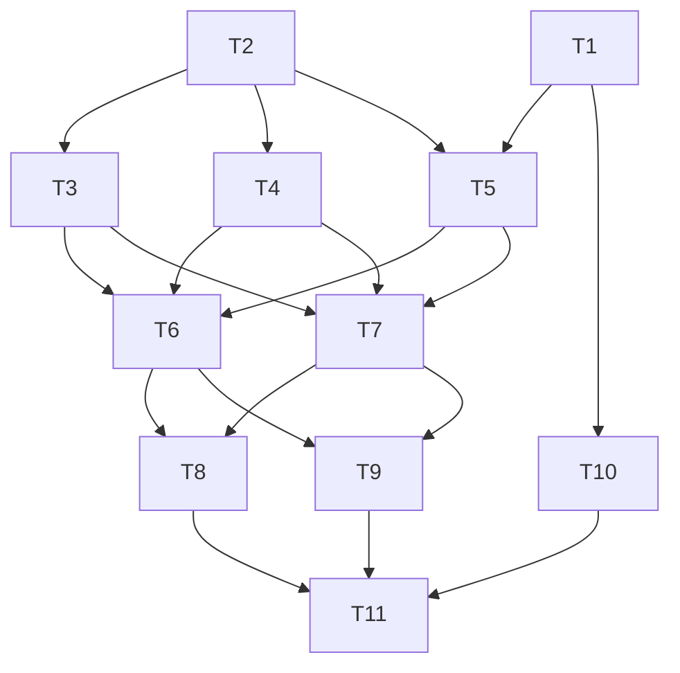

# Contacts Module Implementation Plan

> **For agentic workers:** REQUIRED SUB-SKILL: Use superpowers:subagent-driven-development (recommended) or superpowers:executing-plans to implement this plan task-by-task. Steps use checkbox (`- [ ]`) syntax for tracking.

**Goal:** Build the Contacts module (Domain, Application, Infrastructure and Presentation layers), its session-authenticated HTTP API, its CLI, the auth endpoints and the OpenAPI contract.

**Architecture:**
- Each use case is one Action in `app/Modules/Contacts/Application`. The Action is fed by a shared validator, then an input-specific assembler, then a `final readonly` DTO.
- Controllers, console commands and a queued job are thin entry points in `Presentation`.
- Errors render as RFC 9457 problem details from one place.
- Telephony is a port in Domain, with a random fake adapter in Infrastructure.

**Tech Stack:** Laravel 13, PHP 8.5, Pest 5, SQLite (local and tests), core Laravel only.

**Spec:** `docs/superpowers/specs/2026-11-01-contacts-module-design.md`

## Global Constraints

**Before coding:**
- Read `.claude/rules/architecture.md`, `testing.md`, `commits.md` and `package-management.md`.
- Activate the `laravel-best-practices` skill.
- Use `search-docs` for Laravel APIs.

**Dependencies:** core Laravel only. No new Composer or pnpm dependencies.

**PHP style:**
- Every new PHP file starts with `declare(strict_types=1);`.
- Classes are `final` unless they're abstract.
- DTOs and value objects are `final readonly`.
- Explicit parameter and return types everywhere.
- PHPDoc array shapes for every array parameter or return.
- Curly braces always.
- Pint runs automatically after each PHP edit, through the lint hook.

**Namespaces:**
- The module lives under `App\Modules\Contacts\{Domain,Application,Infrastructure,Presentation}`.
- Domain uses nothing from Application, Presentation or Infrastructure.
- Application uses nothing from Presentation or Infrastructure.

**Tests:**
- Colocated: `XTest.php` next to `X.php`.
- No `uses(RefreshDatabase::class)` and no database trait imports. The base `Tests\TestCase` already uses `RefreshDatabase`.
- HTTP tests authenticate with `$this->actingAs(User::factory()->create())`.

**Exact values:**
- **Phone patterns:**
  - AU: `/^\+61[2-478]\d{8}$/`
  - NZ: `/^\+64[2-9]\d{7,9}$/`
  - Input is trimmed, never reformatted.
- **Emails:** trimmed and lowercased. `domain` is the part after the last `@`.
- **Limits:**
  - at most 10 emails and 10 phones per contact (counted before de-duplication);
  - `name` at most 255 characters;
  - `per_page` defaults to 25, with a maximum of 100.
- **Problem `type`:** `/problems/{code}`.
- **Codes and statuses:**
  - `validation_failed` 422
  - `invalid_credentials` 422
  - `contact_not_found` 404
  - `not_found` 404
  - `unauthenticated` 401
  - `csrf_token_mismatch` 419
  - `idempotency_key_missing` 400
  - `idempotency_key_reused` 422
  - `telephony_failed` 502
  - `too_many_requests` 429
  - `server_error` 500
- **Idempotency:** the cache TTL is 24 hours, and only 2xx responses are stored.
- **Demo user:** `demo@example.com` / `password`.

**Commits:**
- `git commit -m "REX-0001: <description>" -m "Co-Authored-By: Claude Opus 5.5 <noreply@anthropic.com>"`.
- Stage explicit paths only. Never stage `.lerd.yaml`, `.node-version`, `.php-version` or `.gitignore`.

**Guards are live:**
- No recursive rm. No `git checkout <path>` or `git restore <path>`.
- No Bash line or quoted string that starts with npm or a destructive command.
- Write files with the Write and Edit tools.

**Before each commit:**
1. Run `review-dry`, `review-solid` and `review-owasp-backend` on every changed and new file, and fix the findings.
2. Run the task's tests.
3. Run `php artisan test --compact` for the full suite.

## Review Focus

These are failure modes the spec implies but the main tests don't exercise, most likely first. Each one is pinned by a test in the task named in brackets.

1. **Search input containing `%` or `_`** must match those characters literally, not act as a wildcard. [T5]
2. **A non-UUID id on a GET, DELETE or calls route** must return a 404 problem response, not a 500 from the database. [T7, T8]
3. **Re-submitting an upsert whose emails differ only by case or whitespace** must change nothing, with the same row IDs. [T4]
4. **An unexpected exception on an API route** must return a generic 500 problem response, with no message, class or trace, even when `APP_DEBUG=true`. [T1]
5. **A contact row appearing between the check and the insert** (concurrent first create) must give `created=false` and no error. [T4]

---

## Dependency Tree

| ID | Task | Depends on | Touches | Wave |
|---|---|---|---|---|
| T1 | Problem details rendering | none | `app/Exceptions/ProblemException.php`, `app/Http/Problems/*`, `bootstrap/app.php` | 1 |
| T2 | Domain: value objects, models, migrations, factories | none | `app/Modules/Contacts/Domain/{ValueObjects,Models,Exceptions}/*`, `database/migrations/*contacts*`, `database/factories/Contacts/*` | 1 |
| T3 | Telephony port and fake adapter | T2 | `app/Modules/Contacts/Domain/Telephony/*`, `app/Modules/Contacts/Infrastructure/*`, `tests/Arch/ArchitectureTest.php` | 2 |
| T4 | Upsert slice | T2 | `Application/Actions/UpsertContact*`, `Application/DTOs/UpsertContactData*`, `Application/Validation/{ContactValidator*,Rules/*}`, `Application/Assemblers/ContactDataFrom*` | 2 |
| T5 | Read, search and delete slice | T1, T2 | `Application/Actions/{GetContact,SearchContacts,DeleteContact}*`, `Application/DTOs/SearchContactsData*`, `Application/Validation/SearchContactsValidator*`, `Application/Assemblers/SearchContactsDataFrom*`, `Application/Exceptions/ContactNotFound.php` | 2 |
| T10 | Auth endpoints and demo seeder | T1 | `app/Http/Controllers/Auth/*`, `app/Exceptions/InvalidCredentials.php`, `app/Providers/AppServiceProvider.php`, `routes/web.php`, `database/seeders/DatabaseSeeder.php` | 2 |
| T6 | Call slice | T3, T4, T5 | `Application/Actions/CallContact*`, `Application/DTOs/{CallContactData,CallResult}*`, `Application/Validation/CallValidator*`, `Application/Assemblers/CallContactDataFrom*`, `Application/Exceptions/TelephonyFailed.php` | 3 |
| T7 | Module wiring and contacts HTTP endpoints | T3, T4, T5 | `app/Modules/Contacts/ContactsServiceProvider.php`, `bootstrap/providers.php`, `Presentation/Http/{routes.php,Controllers/ContactController*,Resources/ContactResource*}` | 3 |
| T8 | Call endpoint and idempotency middleware | T6, T7 | `Presentation/Http/{routes.php,Controllers/CallController*,Middleware/*,Exceptions/*,Resources/CallResource*}` | 4 |
| T9 | CLI commands and queued call job | T6, T7 | `Presentation/Console/*`, `Presentation/Queue/*`, `app/Modules/Contacts/ContactsServiceProvider.php` | 4 |
| T11 | OpenAPI contract and route-parity test | T8, T9, T10 | `Presentation/Http/openapi.json`, `Presentation/Http/OpenApiContractTest.php` | 5 |

Paths without a prefix are relative to `app/Modules/Contacts/`. No two tasks in the same wave touch the same file, so tasks in one wave can run in parallel. For sequential execution, use the order T1, T2, T3, T4, T5, T10, T6, T7, T8, T9, T11.

---

### Task 1: Problem details rendering

**Files:**
- Create: `app/Exceptions/ProblemException.php`
- Create: `app/Http/Problems/ProblemDetails.php`
- Create: `app/Http/Problems/ProblemRenderer.php`
- Modify: `bootstrap/app.php`
- Test: `app/Http/Problems/ProblemRendererTest.php`

**Interfaces (Produces):**
- `abstract class App\Exceptions\ProblemException extends \RuntimeException`, with:
  - `abstract public function problemCode(): string`
  - `abstract public function status(): int`
  - `abstract public function title(): string`
  - `/** @return array<string, mixed> */ public function extensions(): array` (default `[]`)
  
  `getMessage()` is the `detail`.
- `final class App\Http\Problems\ProblemDetails`, with `public static function response(int $status, string $code, string $title, string $detail, array $extensions = [], array $headers = []): JsonResponse`. The body is `{type: "/problems/{code}", title, status, detail, code, ...extensions}`, with `Content-Type: application/problem+json`.
- `final class App\Http\Problems\ProblemRenderer`, with `public static function render(\Throwable $e): JsonResponse`. It maps:

  | Exception | Status and code | Notes |
  |---|---|---|
  | `ProblemException` | its own status and code | |
  | `ValidationException` | 422 `validation_failed` | adds `errors: $e->errors()` |
  | `AuthenticationException` | 401 `unauthenticated` | |
  | `TokenMismatchException`, or `HttpException` with status 419 | 419 `csrf_token_mismatch` | |
  | `ThrottleRequestsException` | 429 `too_many_requests` | keeps its headers |
  | `NotFoundHttpException` or `ModelNotFoundException` | 404 `not_found` | |
  | any other `HttpExceptionInterface` | its status, code `http_error` | |
  | anything else | 500 `server_error` | detail `An unexpected error occurred.` |

- `bootstrap/app.php`:
  - add `'login', 'logout'` to the `shouldRenderJsonWhen` paths;
  - register a render callback that uses `ProblemRenderer::render()` for requests to `api/*`, `login` or `logout`, or that expect JSON, and returns `null` for everything else, so web pages keep Laravel's default handling.

- [ ] **Step 1: Write the failing tests** in `ProblemRendererTest.php`. They register throwaway routes in `beforeEach` with `Route::middleware('web')->get('api/test/...', fn () => throw …)`:
  - `it('renders validation errors as problem details')`: status 422, `code` = `validation_failed`, `type` = `/problems/validation_failed`, `errors.name` present, `Content-Type` contains `application/problem+json`.
  - `it('renders a ProblemException with its own code and status')`: use an anonymous subclass with code `teapot_test` and status 418.
  - `it('renders unauthenticated as 401')`, `it('renders throttling as 429 with Retry-After')` and `it('renders an unknown route as 404 not_found')`.
  - `it('hides internals of unexpected exceptions even in debug mode')`: set `config(['app.debug' => true])`, throw `new RuntimeException('SQLSTATE secret')`, then assert status 500, `code` = `server_error`, and that the response body does not contain `SQLSTATE`, `RuntimeException` or `trace`. This pins Review Focus 4.

- [ ] **Step 2: Run them and check they fail.** Run `php artisan test --compact app/Http/Problems/ProblemRendererTest.php`. Expected: FAIL, because the classes don't exist.

- [ ] **Step 3: Implement** the three classes and the `bootstrap/app.php` change, as specified above.

- [ ] **Step 4: Run them and check they pass.** Same command. Expected: PASS. Then run the full suite: `php artisan test --compact`.

- [ ] **Step 5: Commit** with the message `REX-0001: render errors as rfc 9457 problem details`.

---

### Task 2: Domain value objects, models, migrations and factories

**Files:**
- Create: `app/Modules/Contacts/Domain/ValueObjects/PhoneNumber.php`
- Create: `app/Modules/Contacts/Domain/ValueObjects/EmailAddress.php`
- Create: `app/Modules/Contacts/Domain/Exceptions/InvalidPhoneNumber.php`
- Create: `app/Modules/Contacts/Domain/Exceptions/InvalidEmailAddress.php`
- Create: `app/Modules/Contacts/Domain/Models/Contact.php`
- Create: `app/Modules/Contacts/Domain/Models/ContactEmail.php`
- Create: `app/Modules/Contacts/Domain/Models/ContactPhone.php`
- Create: `database/migrations/2026_11_01_000001_create_contacts_table.php`
- Create: `database/migrations/2026_11_01_000002_create_contact_emails_table.php`
- Create: `database/migrations/2026_11_01_000003_create_contact_phones_table.php`
- Create: `database/factories/Contacts/ContactFactory.php`
- Create: `database/factories/Contacts/ContactEmailFactory.php`
- Create: `database/factories/Contacts/ContactPhoneFactory.php`
- Tests: `PhoneNumberTest.php` and `EmailAddressTest.php` (next to the value objects), and `Domain/Models/ContactTest.php`

**Interfaces (Produces):**
- **`PhoneNumber`:**
  - `final readonly class PhoneNumber { public string $value; }`, with a private constructor.
  - `public static function fromString(string $value): self` trims, then matches the AU or NZ pattern. Otherwise it throws `InvalidPhoneNumber`.
  - `public function equals(self $other): bool`
  - `public function __toString(): string`
- **`EmailAddress`:**
  - `final readonly class EmailAddress { public string $value; }`
  - `public static function fromString(string $value): self` trims and lowercases, then checks with `filter_var(…, FILTER_VALIDATE_EMAIL)`. Otherwise it throws `InvalidEmailAddress`.
  - `public function domain(): string`
  - `public function equals(self $other): bool`
  - `public function __toString(): string`
- **Exceptions:** `InvalidPhoneNumber` and `InvalidEmailAddress` are `final` and extend `\InvalidArgumentException`. Each message names the expected format.
- **`Contact`:**
  - `#[UseFactory(ContactFactory::class)]`, plus the `HasUuids` and `HasFactory` traits.
  - Fillable: `id`, `name`.
  - `emails(): HasMany` and `phones(): HasMany`, both ordered by `id`.
- **`ContactEmail`:** fillable `contact_id`, `email`, `domain`; `contact(): BelongsTo`.
- **`ContactPhone`:** fillable `contact_id`, `phone`; `contact(): BelongsTo`.
- **Tables:**
  - `contacts`: `uuid('id')->primary()`, `string('name', 255)->index()`, timestamps.
  - `contact_emails`: `id()`, `foreignUuid('contact_id')->constrained()->cascadeOnDelete()`, `string('email', 254)`, `string('domain', 253)->index()`, timestamps, `unique(['contact_id', 'email'])`.
  - `contact_phones`: `id()`, `foreignUuid('contact_id')->constrained()->cascadeOnDelete()`, `string('phone', 16)`, timestamps, `unique(['contact_id', 'phone'])`.
- **Factories** (namespace `Database\Factories\Contacts`): valid values only. Phones look like `+614` followed by 8 random digits; emails come from `fake()->unique()->safeEmail()`, with `domain` derived.

- [ ] **Step 1: Write the failing tests.**
  - `PhoneNumberTest`, using datasets:
    - accepts `+61412345678`, `+61298765432`, `+6421234567`, `+642123456789`, `+6493012345`, and `' +61412345678 '` (stored as `+61412345678`);
    - rejects `0412345678`, `+61 412 345 678`, `+1415555 0100`, `+4420794600 00`, `+6141234567` (too short), `+614123456789` (too long), `+61512345678` (bad AU prefix), `+6411234567` (bad NZ prefix), and `''`;
    - `toThrow(InvalidPhoneNumber::class)`.
  - `EmailAddressTest`:
    - `' Jo@Rex.COM.au '` normalises to `jo@rex.com.au`, with domain `rex.com.au`;
    - rejects `not-an-email` and `a@`.
  - `ContactTest`:
    - a contact created by its factory with 2 emails and 1 phone loads its relations in insertion order;
    - deleting the contact cascades to the child rows;
    - inserting a duplicate (contact, email) row throws `UniqueConstraintViolationException`.
- [ ] **Step 2: Run them and check they fail.** Run `php artisan test --compact app/Modules/Contacts/Domain`. Expected: FAIL.
- [ ] **Step 3: Implement** everything listed above.
- [ ] **Step 4: Run them and check they pass.** Same command (PASS), then `php artisan migrate:status` to confirm the three migrations are listed.
- [ ] **Step 5: Commit** with the message `REX-0001: contacts domain models and value objects`.

---

### Task 3: Telephony port and fake adapter

**Files:**
- Create: `app/Modules/Contacts/Domain/Telephony/CallOutcome.php`
- Create: `app/Modules/Contacts/Domain/Telephony/TelephonyGateway.php`
- Create: `app/Modules/Contacts/Infrastructure/FakeTelephonyGateway.php`
- Modify: `tests/Arch/ArchitectureTest.php`
- Test: `app/Modules/Contacts/Infrastructure/FakeTelephonyGatewayTest.php`

**Interfaces:**
- **Consumes:** `PhoneNumber` (T2).
- **Produces:**
  - `enum CallOutcome: string` with the cases `Answered = 'answered'`, `NoAnswer = 'no_answer'`, `Busy = 'busy'`, `Voicemail = 'voicemail'`, `Rejected = 'rejected'` and `Failed = 'failed'`.
  - `interface TelephonyGateway { public function place(PhoneNumber $to): CallOutcome; }`
  - `final class FakeTelephonyGateway implements TelephonyGateway`, with the constructor `__construct(private Randomizer $randomizer = new Randomizer())`. It uses `Random\Randomizer`, which Pest's security preset allows, unlike `rand` and `array_rand`.

- [ ] **Step 1: Write the failing tests.**
  - `it('returns a CallOutcome')`.
  - `it('is deterministic with a seeded engine')`: two gateways built with `new Randomizer(new Mt19937(42))` return the same sequence over 5 calls.
  - `it('can return every outcome')`: over 200 calls with a seeded engine, the set of outcomes equals `CallOutcome::cases()`.
  - In `ArchitectureTest.php`, inside the existing loop, add `arch("{$module} inner layers do not depend on infrastructure")->expect(["{$module}\\Domain", "{$module}\\Application"])->not->toUse("{$module}\\Infrastructure");`.
- [ ] **Step 2: Run them and check they fail.** Run `php artisan test --compact app/Modules/Contacts/Infrastructure`. Expected: FAIL.
- [ ] **Step 3: Implement** the enum, the interface and the fake.
- [ ] **Step 4: Run them and check they pass.** Run `php artisan test --compact app/Modules/Contacts/Infrastructure tests/Arch`. Expected: PASS.
- [ ] **Step 5: Commit** with the message `REX-0001: telephony port with random fake gateway`.

---

### Task 4: Upsert slice

**Files:**
- Create: `app/Modules/Contacts/Application/Validation/Rules/ValidPhoneNumber.php`
- Create: `app/Modules/Contacts/Application/Validation/Rules/ValidEmailAddress.php`
- Create: `app/Modules/Contacts/Application/Validation/ContactValidator.php`
- Create: `app/Modules/Contacts/Application/DTOs/UpsertContactData.php`
- Create: `app/Modules/Contacts/Application/DTOs/UpsertResult.php`
- Create: `app/Modules/Contacts/Application/Assemblers/ContactDataFromRequest.php`
- Create: `app/Modules/Contacts/Application/Assemblers/ContactDataFromCli.php`
- Create: `app/Modules/Contacts/Application/Actions/UpsertContact.php`
- Tests: `ContactValidatorTest.php`, `ContactDataFromRequestTest.php`, `ContactDataFromCliTest.php` and `UpsertContactTest.php`, each next to its class

**Interfaces:**
- **Consumes:** T2's value objects and models.
- **Produces:**
  - **Rules:**
    - `ValidPhoneNumber implements ValidationRule` delegates to `PhoneNumber::fromString`. Its message is `The :attribute must be an E.164 Australian (+61) or New Zealand (+64) number, for example +61412345678.`
    - `ValidEmailAddress implements ValidationRule` delegates the same way, with the message `The :attribute must be a valid email address.`
  - **`ContactValidator::validate(array $input): array`** returns `array{id: string, name: string, emails: list<string>, phones: list<string>}`, or throws `ValidationException`. The rules:
    - `id`: `required|uuid`
    - `name`: `required|string|max:255`
    - `emails`: `required|array|min:1|max:10`
    - `emails.*`: `required|string|max:254` plus `ValidEmailAddress`
    - `phones`: `required|array|min:1|max:10`
    - `phones.*`: `required|string` plus `ValidPhoneNumber`
  - **`UpsertContactData`:** `final readonly class UpsertContactData { public function __construct(public string $id, public string $name, /** @var list<EmailAddress> */ public array $emails, /** @var list<PhoneNumber> */ public array $phones) }`, plus `public static function fromValidated(array $validated): self`. This builds the value objects and de-duplicates by `value`, keeping the first occurrence.
  - **`UpsertResult`:** `final readonly class UpsertResult { public function __construct(public Contact $contact, public bool $created) }`.
  - **Assemblers:**
    - `ContactDataFromRequest::assemble(Request $request, string $id): UpsertContactData` validates `['id' => $id] + $request->only('name', 'emails', 'phones')`.
    - `ContactDataFromCli::assemble(?string $id, string $name, array $emails, array $phones): UpsertContactData` uses `$id ?? (string) Str::uuid()`.
  - **`UpsertContact::handle(UpsertContactData $data): UpsertResult`:**
    1. Open `DB::transaction`.
    2. Create the contact if its id doesn't exist yet, using Laravel's `createOrFirst` so a concurrent first create is safe. Take `created` from whether this request inserted the row.
    3. Re-read the row with `lockForUpdate()`.
    4. Update the name if it changed.
    5. Sync the emails:
       - Insert the missing values with `insertOrIgnore`, setting `domain` and the timestamps explicitly. Don't use Laravel's `upsert` with an empty update list: in Laravel 13 it falls back to a plain insert and violates the unique index.
       - Delete the stored emails that are no longer submitted, comparing the same normalised values that were inserted.
    6. Sync the phones the same way.
    7. Return the contact with `emails` and `phones` loaded.

- [ ] **Step 1: Write the failing tests.**
  - **`ContactValidatorTest`:**
    - Accepts a valid payload.
    - Each of these fails on the named key:
      - a missing `name`;
      - `name` over 255 characters;
      - `emails` = [];
      - 11 emails;
      - an invalid `emails.1`, with an error on `emails.1`;
      - phone `0412345678`, with an error message containing `E.164`;
      - an `id` that isn't a UUID.
  - **`UpsertContactTest`:**
    - `it('creates a contact with emails and phones')`: `created` is true, and there is 1 contact, 2 email rows with the correct `domain`, and 1 phone row.
    - `it('is idempotent')`: handling the same data twice gives `created` = false the second time, and identical email and phone row IDs and counts.
    - `it('updates the name and syncs children')`: after a second upsert with one email removed and one added, exactly the new set is stored and the unchanged email keeps its row ID.
    - `it('de-duplicates values that normalise to the same email')`: `['A@x.com', ' a@x.com']` gives one row. Re-submitting with `['a@X.COM']` keeps the same row ID. This pins Review Focus 3.
    - `it('handles a concurrent first create')`: insert the contact row directly with `DB::table('contacts')->insert(...)` before calling `handle()` with the same ID. The result has `created` = false and no exception. This pins Review Focus 5.
  - **Assembler tests:**
    - `ContactDataFromRequest`: an invalid payload throws `ValidationException`.
    - `ContactDataFromCli`: with a null id, the result has a UUID id.
- [ ] **Step 2: Run them and check they fail.** Run `php artisan test --compact app/Modules/Contacts/Application`. Expected: FAIL.
- [ ] **Step 3: Implement** everything as specified above.
- [ ] **Step 4: Run them and check they pass.** Same command. Expected: PASS.
- [ ] **Step 5: Commit** with the message `REX-0001: idempotent atomic contact upsert`.

---

### Task 5: Read, search and delete slice

**Files:**
- Create: `app/Modules/Contacts/Application/Exceptions/ContactNotFound.php`
- Create: `app/Modules/Contacts/Application/Actions/GetContact.php`
- Create: `app/Modules/Contacts/Application/Actions/DeleteContact.php`
- Create: `app/Modules/Contacts/Application/Actions/SearchContacts.php`
- Create: `app/Modules/Contacts/Application/DTOs/SearchContactsData.php`
- Create: `app/Modules/Contacts/Application/Validation/SearchContactsValidator.php`
- Create: `app/Modules/Contacts/Application/Assemblers/SearchContactsDataFromRequest.php`
- Create: `app/Modules/Contacts/Application/Assemblers/SearchContactsDataFromCli.php`
- Tests: next to each action, the validator and both assemblers

**Interfaces:**
- **Consumes:** `ProblemException` (T1), and the models and factories (T2).
- **Produces:**
  - **`ContactNotFound`:** `final class ContactNotFound extends ProblemException`. It has status 404, code `contact_not_found` and title `Contact not found`. The detail is `No contact exists with id {id}.`, and it has `public static function withId(string $id): self`.
  - **`GetContact::handle(string $id): Contact`** loads the contact with emails and phones, or throws `ContactNotFound`.
  - **`DeleteContact::handle(string $id): void`** throws `ContactNotFound` when nothing was deleted.
  - **`SearchContactsData`:** `final readonly class SearchContactsData { public function __construct(public ?string $name, public ?string $phoneDigits, public ?string $emailDomain, public int $page = 1, public int $perPage = 25) }`.
  - **`SearchContactsValidator::validate(array $input): array`** returns `array{name?: string|null, phone?: string|null, email_domain?: string|null, page?: int|null, per_page?: int|null}`. The rules:
    - `name`: `nullable|string|max:255`
    - `phone`: `nullable|string|max:20|regex:/^\+?[0-9]+$/`
    - `email_domain`: `nullable|string|max:253`
    - `page`: `nullable|integer|min:1`
    - `per_page`: `nullable|integer|min:1|max:100`
  - **Assemblers:**
    - `SearchContactsDataFromRequest::assemble(Request $request): SearchContactsData`.
    - `SearchContactsDataFromCli::assemble(array $options): SearchContactsData`, taking the option keys `name`, `phone`, `domain`, `page` and `per-page`. It maps `domain` to `email_domain` and `per-page` to `per_page` before validating.

    Both strip non-digits from the phone and lowercase the domain.
  - **`SearchContacts::handle(SearchContactsData $data): LengthAwarePaginator`**, documented as `LengthAwarePaginator<int, Contact>`:
    - `name`: `whereRaw('lower(name) like ? escape ?', ['%'.escaped(lowercase).'%', '\\'])`, where escaping puts `\` before `\`, `%` and `_`;
    - phone: `whereHas('phones', phone like %digits% escaped)`;
    - domain: `whereHas('emails', domain = ?)`;
    - `with(['emails', 'phones'])`, `orderBy('name')->orderBy('id')`, then `paginate($perPage, page: $page)`.

- [ ] **Step 1: Write the failing tests.**
  - **`GetContactTest`:** returns the contact with its relations loaded; an unknown UUID throws `ContactNotFound` with `problemCode()` `contact_not_found`.
  - **`DeleteContactTest`:** deletes the contact and its children; deleting a second time throws `ContactNotFound`.
  - **`SearchContactsTest`:**
    - `name` "smi" finds "Jane Smith" (case-insensitive);
    - `phoneDigits` "1234" finds `+61412341234`;
    - `emailDomain` `rex.com.au` finds `jo@rex.com.au` and not `jo@notrex.com.au`;
    - filters combine with AND;
    - no filters returns everything, ordered by name;
    - `perPage` 2 over 3 contacts gives 2 items and a total of 3;
    - `it('treats % and _ literally')`: with contacts "100% Agency" and "Bob", `name` = `%` returns only "100% Agency". This pins Review Focus 1.
  - **Validator test:** `per_page` 101 fails, and `phone` `abc` fails.
  - **Assembler tests:** the CLI option `per-page` maps to `perPage`; `+61 412` in a request gives `phoneDigits` `61412`.
- [ ] **Step 2: Run them and check they fail.** Run `php artisan test --compact app/Modules/Contacts/Application`. Expected: the new tests fail.
- [ ] **Step 3: Implement** everything as specified above.
- [ ] **Step 4: Run them and check they pass.** Same command. Expected: PASS.
- [ ] **Step 5: Commit** with the message `REX-0001: get, search and delete contacts`.

---

### Task 10: Auth endpoints and demo seeder

**Files:**
- Create: `app/Http/Controllers/Auth/LoginController.php`
- Create: `app/Http/Controllers/Auth/LogoutController.php`
- Create: `app/Http/Controllers/Auth/MeController.php`
- Create: `app/Exceptions/InvalidCredentials.php`
- Modify: `routes/web.php`
- Modify: `app/Providers/AppServiceProvider.php`
- Modify: `database/seeders/DatabaseSeeder.php`
- Test: `app/Http/Controllers/Auth/AuthenticationTest.php`

**Interfaces:**
- **Consumes:** `ProblemException` (T1).
- **Produces:**
  - **Routes:**
    - `POST /login` → `LoginController` (`__invoke(Request): JsonResponse`), named `login`, with middleware `throttle:login`. The name `login` is required: Laravel's default guest redirect calls `route('login')` for non-JSON requests, and a missing route would throw.
    - `POST /logout` → `LogoutController` (204), named `logout`, with middleware `auth`.
    - `GET /api/v1/me` → `MeController` (`{id, name, email}`), named `me`, with middleware `auth`.
  - **`InvalidCredentials`:** status 422, code `invalid_credentials`, title `Invalid credentials`, detail `These credentials do not match our records.`
  - **Rate limiter:** `RateLimiter::for('login', …)` allows 5 per minute, keyed by the lowercased email plus the IP. It's registered in `AppServiceProvider::boot`.
  - **Login flow:** validate `email` (`required|email`) and `password` (`required|string`), then `Auth::attempt`, then `session()->regenerate()`, then return 200 with `{id, name, email}`.
  - **Logout flow:** `Auth::guard('web')->logout()`, then `session()->invalidate()`, then `regenerateToken()`.
  - **Seeder:** creates `User::factory()->create(['name' => 'Demo User', 'email' => 'demo@example.com'])`. The factory's default password is `password`.

- [ ] **Step 1: Write the failing tests.**
  - Logging in with the right credentials gives 200 with the email, and `assertAuthenticated()`.
  - A wrong password gives 422 `invalid_credentials`. An unknown email gives the *same* status, code and detail.
  - `GET /api/v1/me` gives 401 `unauthenticated` as a guest, and 200 with `{id, name, email}` when authenticated.
  - Logout gives 204, then `assertGuest()`.
  - The 6th login attempt within a minute gives 429 `too_many_requests`.
- [ ] **Step 2: Run them and check they fail.** Run `php artisan test --compact app/Http/Controllers/Auth`. Expected: FAIL.
- [ ] **Step 3: Implement** everything as specified above.
- [ ] **Step 4: Run them and check they pass.** Same command (PASS), then `php artisan db:seed --class=DatabaseSeeder` against a fresh local database, or confirm with tinker that the demo user exists.
- [ ] **Step 5: Commit** with the message `REX-0001: session login, logout and me endpoints`.

---

### Task 6: Call slice

**Files:**
- Create: `app/Modules/Contacts/Application/Exceptions/TelephonyFailed.php`
- Create: `app/Modules/Contacts/Application/DTOs/CallContactData.php`
- Create: `app/Modules/Contacts/Application/DTOs/CallResult.php`
- Create: `app/Modules/Contacts/Application/Validation/CallValidator.php`
- Create: `app/Modules/Contacts/Application/Assemblers/CallContactDataFromRequest.php`
- Create: `app/Modules/Contacts/Application/Assemblers/CallContactDataFromCli.php`
- Create: `app/Modules/Contacts/Application/Actions/CallContact.php`
- Tests: next to the action and the validator

**Interfaces:**
- **Consumes:** `TelephonyGateway` and `CallOutcome` (T3); `ValidPhoneNumber` (T4); `ContactNotFound` (T5).
- **Produces:**
  - **`TelephonyFailed`:** `extends ProblemException`, with status 502, code `telephony_failed`, title `Call could not be placed`. The detail is `The telephony provider failed to place the call to {phone}.`
  - **`CallContactData`:** `final readonly class CallContactData { public function __construct(public string $contactId, public ?PhoneNumber $phone) }`.
  - **`CallResult`:** `final readonly class CallResult { public function __construct(public string $contactId, public PhoneNumber $dialled, public CallOutcome $outcome, public CarbonImmutable $placedAt) }`.
  - **`CallValidator::validate(array $input): array`** returns `array{phone?: string|null}`, with `phone` = `nullable|string` plus `ValidPhoneNumber`.
  - **Assemblers:** `CallContactDataFromRequest::assemble(Request $request, string $contactId): CallContactData` and `CallContactDataFromCli::assemble(string $contactId, ?string $phone): CallContactData`.
  - **`CallContact::handle(CallContactData $data): CallResult`:**
    1. Load the contact, or throw `ContactNotFound`.
    2. Choose the number:
       - if a phone was given and it isn't one of the contact's phones, throw `ValidationException::withMessages(['phone' => "The phone must be one of this contact's phone numbers."])`;
       - with no phone given, use the earliest phone, ordered by `id`.
    3. `$outcome = $gateway->place($number)`.
    4. If the outcome is `Failed`, throw `TelephonyFailed`.
    5. Return a `CallResult` with `placedAt` = `CarbonImmutable::now()`.

- [ ] **Step 1: Write the failing tests** in `CallContactTest`. Bind `TelephonyGateway` to an anonymous class that returns a fixed outcome and records the numbers dialled.
  - Use a dataset covering every outcome except `Failed`: the result carries that outcome.
  - `Failed` throws `TelephonyFailed`.
  - With no phone given, the earliest phone is dialled.
  - A given phone that belongs to the contact is dialled.
  - A valid AU phone that doesn't belong to the contact throws `ValidationException` with an error on `phone`, and the gateway is never called.
  - An unknown contact throws `ContactNotFound`.

  In `CallValidatorTest`: `0412345678` fails, and null passes.
- [ ] **Step 2: Run them and check they fail.** Run `php artisan test --compact app/Modules/Contacts/Application`. Expected: the new tests fail.
- [ ] **Step 3: Implement** everything as specified above.
- [ ] **Step 4: Run them and check they pass.** Same command. Expected: PASS.
- [ ] **Step 5: Commit** with the message `REX-0001: call contact through the telephony port`.

---

### Task 7: Module wiring and contacts HTTP endpoints

**Files:**
- Create: `app/Modules/Contacts/ContactsServiceProvider.php`
- Modify: `bootstrap/providers.php`
- Create: `app/Modules/Contacts/Presentation/Http/routes.php`
- Create: `app/Modules/Contacts/Presentation/Http/Controllers/ContactController.php`
- Create: `app/Modules/Contacts/Presentation/Http/Resources/ContactResource.php`
- Test: `app/Modules/Contacts/Presentation/Http/Controllers/ContactControllerTest.php`

**Interfaces:**
- **Consumes:** the T4 and T5 actions and assemblers, and `FakeTelephonyGateway` (T3).
- **Produces:**
  - **`ContactsServiceProvider`:**
    - `register()` binds `TelephonyGateway::class` to `FakeTelephonyGateway::class`.
    - `boot()` defines `RateLimiter::for('api', …)` at 60 per minute, keyed by user ID or IP. Then it runs `Route::middleware(['web', 'auth', 'throttle:api'])->prefix('api/v1')->name('contacts.')->group(__DIR__.'/Presentation/Http/routes.php')`.
    - It is listed in `bootstrap/providers.php`.
  - **Routes:**

    | Route | Name | Action | Constraint |
    |---|---|---|---|
    | `PUT contacts/{id}` | `contacts.upsert` | `ContactController@upsert` | none, because the validator checks the UUID |
    | `GET contacts/{id}` | `contacts.show` | `show` | `whereUuid('id')` |
    | `GET contacts` | `contacts.index` | `index` | |
    | `DELETE contacts/{id}` | `contacts.destroy` | `destroy` | `whereUuid('id')` |

  - **`ContactController` methods:**
    - `upsert(Request $request, string $id, ContactDataFromRequest $assembler, UpsertContact $action): JsonResponse`: 201 or 200, with a `ContactResource` body.
    - `show(string $id, GetContact $action): ContactResource`
    - `index(Request $request, SearchContactsDataFromRequest $assembler, SearchContacts $action): AnonymousResourceCollection`
    - `destroy(string $id, DeleteContact $action): Response`: 204.
  - **`ContactResource`:** `{id, name, emails: list<string>, phones: list<string>, created_at, updated_at}`. The collection includes Laravel's standard `meta` and `links` for pagination.

- [ ] **Step 1: Write the failing tests**, authenticated unless stated:
  - PUT with a new UUID gives 201 and the body shape; the same PUT again gives 200 with an identical body apart from `updated_at`.
  - PUT with an invalid phone gives 422 `validation_failed` and an error on `phones.0`.
  - PUT with the id `not-a-uuid` gives 422 with an error on `id`.
  - GET of an existing contact gives 200; GET of an unknown UUID gives 404 `contact_not_found`.
  - `it('returns 404 not_found for a non-uuid id')`: GET `/api/v1/contacts/abc` gives 404 `not_found`, and so does DELETE. This pins Review Focus 2.
  - The index with `email_domain=rex.com.au&per_page=1` gives 200 with 1 item and `meta.total`.
  - DELETE gives 204, then 404 `contact_not_found`.
  - A guest GET of the index gives 401 `unauthenticated`.
- [ ] **Step 2: Run them and check they fail.** Run `php artisan test --compact app/Modules/Contacts/Presentation/Http`. Expected: FAIL.
- [ ] **Step 3: Implement** everything as specified above.
- [ ] **Step 4: Run them and check they pass.** Same command (PASS), then `php artisan route:list --path=api/v1` to confirm the 4 routes and their names.
- [ ] **Step 5: Commit** with the message `REX-0001: contacts http endpoints`.

---

### Task 8: Call endpoint and idempotency middleware

**Files:**
- Create: `app/Modules/Contacts/Presentation/Http/Exceptions/IdempotencyKeyMissing.php`
- Create: `app/Modules/Contacts/Presentation/Http/Exceptions/IdempotencyKeyReused.php`
- Create: `app/Modules/Contacts/Presentation/Http/Middleware/EnsureIdempotency.php`
- Create: `app/Modules/Contacts/Presentation/Http/Controllers/CallController.php`
- Create: `app/Modules/Contacts/Presentation/Http/Resources/CallResource.php`
- Modify: `app/Modules/Contacts/Presentation/Http/routes.php`
- Tests: `EnsureIdempotencyTest.php` and `CallControllerTest.php`, each next to its class

**Interfaces:**
- **Consumes:** `CallContact`, `CallContactDataFromRequest` and `CallResult` (T6); the routes file (T7).
- **Produces:**
  - **Exceptions:**
    - `IdempotencyKeyMissing`: status 400, code `idempotency_key_missing`. The detail is `The Idempotency-Key header is required for this endpoint.`
    - `IdempotencyKeyReused`: status 422, code `idempotency_key_reused`. The detail is `This Idempotency-Key was already used with a different request.`
  - **`EnsureIdempotency::handle(Request $request, Closure $next): Response`:**
    - It requires the header. The key is at most 255 characters.
    - The cache key is `idempotency:{userId}:{routeName}:` followed by `hash('sha256', key)`.
    - The fingerprint is `hash('sha256', method . path . raw body)`.
    - It wraps the work in `Cache::lock($cacheKey.':lock', 10)->block(5, …)`.
    - If a stored entry has a different fingerprint, it throws `IdempotencyKeyReused`.
    - If a stored entry has the same fingerprint, it returns the stored status, body and `Content-Type`, plus the header `Idempotency-Replayed: true`.
    - Otherwise it runs the request and stores the response for 24 hours, but only if it's 2xx.
  - **Route:** `POST contacts/{id}/calls`, named `contacts.calls.store`, with `whereUuid('id')` and the `EnsureIdempotency` middleware.
  - **`CallController::store(Request $request, string $id, CallContactDataFromRequest $assembler, CallContact $action): CallResource`** returns 200.
  - **`CallResource`:** `{contact_id, phone, outcome, placed_at}`, where `outcome` is the enum's value.

- [ ] **Step 1: Write the failing tests.** Bind a recording gateway with a fixed outcome, and authenticate.
  - `Busy` gives 200 with `outcome` = `busy`.
  - `Failed` gives 502 `telephony_failed`.
  - No header gives 400 `idempotency_key_missing`, and the gateway is not called.
  - The same key and body twice gives two identical 200 bodies, `Idempotency-Replayed: true` on the second response, and exactly one gateway call.
  - The same key with a different `phone` gives 422 `idempotency_key_reused`.
  - A `Failed` call followed by the same key, with the gateway now returning `Answered`, gives 502 then 200, because a 5xx is never cached.
  - A non-UUID id gives 404 `not_found`.
  - A phone not belonging to the contact gives 422 with an error on `phone`.
- [ ] **Step 2: Run them and check they fail.** Run `php artisan test --compact app/Modules/Contacts/Presentation/Http`. Expected: the new tests fail.
- [ ] **Step 3: Implement** everything as specified above.
- [ ] **Step 4: Run them and check they pass.** Same command. Expected: PASS.
- [ ] **Step 5: Commit** with the message `REX-0001: idempotent call endpoint`.

---

### Task 9: CLI commands and queued call job

**Files:**
- Create: `app/Modules/Contacts/Presentation/Console/Commands/ContactsCommand.php` (abstract base)
- Create: `app/Modules/Contacts/Presentation/Console/ContactTable.php`
- Create: `app/Modules/Contacts/Presentation/Console/Commands/UpsertContactCommand.php`
- Create: `app/Modules/Contacts/Presentation/Console/Commands/ShowContactCommand.php`
- Create: `app/Modules/Contacts/Presentation/Console/Commands/SearchContactsCommand.php`
- Create: `app/Modules/Contacts/Presentation/Console/Commands/DeleteContactCommand.php`
- Create: `app/Modules/Contacts/Presentation/Console/Commands/CallContactCommand.php`
- Create: `app/Modules/Contacts/Presentation/Queue/CallContactJob.php`
- Modify: `app/Modules/Contacts/ContactsServiceProvider.php` (register the commands when running in the console)
- Tests: next to each command, plus `CallContactJobTest.php`

**Interfaces:**
- **Consumes:** all the Application actions and CLI assemblers (T4, T5, T6).
- **Produces:**
  - **`ContactsCommand extends Command`** (abstract). It has `protected function guarded(callable $operation): int`, which:
    - catches `ValidationException`, prints one `field: message` line per error, and returns `self::INVALID`;
    - catches `ProblemException` and prints its message, returning `self::FAILURE`;
    - otherwise returns the callable's result.
  - **`ContactTable`:** `public static function headers(): array` and `public static function rows(iterable $contacts): array`, giving the columns ID, Name, Emails and Phones, with values joined by commas.
  - **Command signatures:**
    - `contacts:upsert {id?} {--name=} {--email=*} {--phone=*} {--json}`: prints `Created contact {id}` or `Updated contact {id}`, then the table.
    - `contacts:show {id} {--json}`
    - `contacts:search {--name=} {--phone=} {--domain=} {--page=1} {--per-page=25} {--json}`: the table, then `Page {n} of {last} ({total} contacts)`.
    - `contacts:delete {id}`: prints `Deleted contact {id}`.
    - `contacts:call {id} {--phone=} {--queue} {--json}`: prints `Called {phone}: {outcome}`. With `--queue`, it dispatches the job instead and prints `Queued call to contact {id}`.

    `--json` prints `json_encode` of the same structure that `ContactResource` or `CallResource` produces.
  - **`CallContactJob implements ShouldQueue`:**
    - Uses `Queueable`.
    - Constructor: `__construct(public CallContactData $data)`.
    - `public int $tries = 3`, and `public function backoff(): array` returning `[10, 30]`.
    - `handle(CallContact $action): void` logs `Log::info('contacts.call', [...])`. It lets `TelephonyFailed` propagate, so the queue retries.

- [ ] **Step 1: Write the failing tests**, using `$this->artisan(...)`:
  - `contacts:upsert --name="Jane Smith" --email=jane@rex.com.au --phone=+61412345678` exits 0 and its output contains `Created contact`. The same command again with the printed ID contains `Updated contact`.
  - `--phone=0412345678` exits with `Command::INVALID` and its output contains `phones.0`.
  - `contacts:show {unknown uuid}` exits 1 and its output contains `No contact exists`.
  - `contacts:search --domain=rex.com.au` contains the name, and so does `--json` output after `json_decode`.
  - `contacts:delete` exits 0, then 1 the second time.
  - `contacts:call {id}` with a fixed `Voicemail` gateway outputs `voicemail`.
  - `contacts:call {id} --queue` with `Queue::fake()` passes `assertPushed(CallContactJob::class)`.
  - `CallContactJobTest`: `handle` with a fixed `Answered` gateway completes. With `Failed` it throws `TelephonyFailed`.
- [ ] **Step 2: Run them and check they fail.** Run `php artisan test --compact app/Modules/Contacts/Presentation/Console app/Modules/Contacts/Presentation/Queue`. Expected: FAIL.
- [ ] **Step 3: Implement** everything as specified above.
- [ ] **Step 4: Run them and check they pass.** Same command (PASS), then `php artisan list contacts` to confirm the 5 commands.
- [ ] **Step 5: Commit** with the message `REX-0001: contacts cli commands and queued call job`.

---

### Task 11: OpenAPI contract and route-parity test

**Files:**
- Create: `app/Modules/Contacts/Presentation/Http/openapi.json`
- Test: `app/Modules/Contacts/Presentation/Http/OpenApiContractTest.php`

**Interfaces:**
- **Consumes:** every route from T7, T8 and T10, the resource shapes, and the problem codes.
- **Produces:**
  - An OpenAPI `3.1.0` document. `info.title` is `Rex CRM Contacts API` and `info.version` is `1.0.0`.
  - **Paths:**
    - `/login` (post) and `/logout` (post);
    - `/api/v1/me` (get);
    - `/api/v1/contacts` (get);
    - `/api/v1/contacts/{id}` (put, get, delete);
    - `/api/v1/contacts/{id}/calls` (post).
  - **`components.schemas`:**
    - `Contact`, `ContactInput` and `ContactPage`;
    - `CallRequest` and `CallResult`;
    - `CallOutcome` (an enum of the 6 values);
    - `User`;
    - `Problem`, which has an `errors` object and a `code` enum of every code in the Global Constraints.
  - **Phone schema:** `pattern: '^\+(61[2-478]\d{8}|64[2-9]\d{7,9})$'`.
  - **`components.parameters`:** `IdempotencyKey` (header, required on the calls operation).
  - **`components.securitySchemes`:** `sessionCookie` (apiKey in a cookie) and `xsrfHeader`.
  - Every operation lists its success response plus each problem response it can return, using `application/problem+json`.

- [ ] **Step 1: Write the failing test** `OpenApiContractTest`:
  - `it('is valid json with openapi 3.1')`.
  - `it('documents exactly the module and auth routes')`:
    1. Collect `Route::getRoutes()` entries whose URI starts with `api/v1/` or equals `login` or `logout`.
    2. Map each to a lowercase method plus `/uri`, excluding `HEAD`.
    3. Compare the set with the documented method and path pairs.
  - `it('documents every problem code')`: the `Problem.code` enum equals the list from the Global Constraints.
- [ ] **Step 2: Run it and check it fails.** Run `php artisan test --compact app/Modules/Contacts/Presentation/Http/OpenApiContractTest.php`. Expected: FAIL, because the file is missing.
- [ ] **Step 3: Write `openapi.json`** as specified above.
- [ ] **Step 4: Run it and check it passes.** Same command (PASS), then `php artisan test --compact` for the full suite.
- [ ] **Step 5: Commit** with the message `REX-0001: openapi contract for contacts api`.
