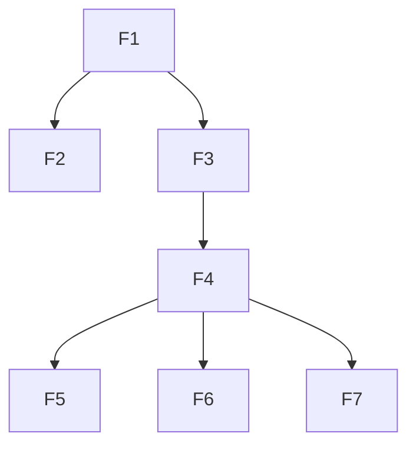

# Contacts SPA Implementation Plan

> **For agentic workers:** REQUIRED SUB-SKILL: Use superpowers:subagent-driven-development (recommended) or superpowers:executing-plans to implement this plan task-by-task. Steps use checkbox (`- [ ]`) syntax for tracking.

**Goal:** Add a React + TypeScript SPA to the Laravel repo. The user signs in as the seeded demo user, then searches, views, creates, edits, deletes and calls contacts through the session-authenticated contacts API.

**Architecture:**
- **Shape:** a Vite-built SPA served by a single Laravel catch-all Blade shell, routed with React Router in data mode.
- **Data:** server state in TanStack Query; all API access through one Axios client typed from `openapi.json` (generated with `openapi-typescript`), with RFC 9457 problems turned into a typed `ApiProblem`.
- **UI:** shadcn/ui defaults with lucide icons.
- **Code layout:** feature modules under `resources/js/modules/{auth,contacts}`, mirroring the backend module.

**Tech Stack:**
- React 19, TypeScript (strict), Vite 8, Tailwind 4, React Router 7 (data mode)
- TanStack Query 5, Axios, react-hook-form, shadcn/ui, lucide-react, sonner
- Vitest with Testing Library and jsdom; ESLint and Prettier; pnpm 11
- Laravel 13 / Pest 5 for the backend-support task

**Spec:** `docs/superpowers/specs/2026-11-01-contacts-spa-design.md`

## Global Constraints

**Packages**
- Use pnpm only. Every dependency change prompts Rob through the `ask-dependency-change` hook; wait for it.
- Never weaken `pnpm-workspace.yaml`: `minimumReleaseAge: 10080`, `trustPolicy: no-downgrade`, `strictDepBuilds: true`, `blockExoticSubdeps: true`.
- If a package is too new, pin an older version. Never add exclusions or `allowBuilds` entries without Rob's say-so.
- No Redux or Zustand.
- No MSW unless Rob approves it. Mock at the module or Axios boundary with `vi.mock`.

**TypeScript and lint**
- TypeScript runs in `strict` mode, with the path alias `@/*` pointing to `resources/js/*`.
- The `lint-frontend` hook runs Prettier and `eslint --fix` on every `.ts` or `.tsx` edit, and blocks on ESLint errors.
- Generated files are lint-ignored and never edited by hand:
  - `resources/js/components/ui/**` (shadcn);
  - `resources/js/lib/api/schema.d.ts` (`openapi-typescript`).

**API access**
- API types come only from `schema.d.ts`. Never hand-write a response type that the schema already defines.
- Axios client defaults: `withCredentials: true`, `withXSRFToken: true`, `Accept: application/json`, `X-Requested-With: XMLHttpRequest`.
- Send an `Idempotency-Key` only on `POST /api/v1/contacts` and `POST /api/v1/contacts/{contact}/calls`.

**UI**
- Icons come from `lucide-react`. Never use emoji.
- The demo hint text is "Demo account: demo@example.com / password". It shows only when `<meta name="app-env">` is not `production`.
- Show error copy from the problem's `title` and `detail`. Never show raw Axios messages.

**Tests and process**
- Colocate tests: `X.test.ts(x)` next to `X.ts(x)`. PHP tests follow the existing Pest rules: colocated, with no database traits.
- Before each commit, invoke `review-dry`, `review-solid`, and `review-owasp-frontend` (frontend) or `review-owasp-backend` (PHP) on the changed and new files.

**Guards and commits**
- Guards are live: no Bash line or quoted string may start with recursive rm, npm, npx or yarn. Use `pnpm`, `pnpm exec` and `pnpm dlx`.
- Run each `git commit` as its own Bash call, then confirm it with `git log --oneline -1`.
- Commit format: `git commit -m "REX-0001: <description>" -m "Co-Authored-By: Claude Opus 5.5 <noreply@anthropic.com>"`.
- Stage explicit paths. Never stage `.lerd.yaml`, `.node-version`, `.php-version` or `.gitignore`.

## Review Focus

1. **Open redirect.** `?redirect=//evil.example` and `?redirect=https://evil.example` after login must be ignored, landing on `/contacts`. [F4]
2. **Double-submitting the create form**, or retrying after a network error, must send the same `Idempotency-Key` and create one contact. [F7]
3. **A 422 error key with no matching field**, such as array-level `emails` ("must have at least 1"), must still show, in a summary alert. [F7]
4. **The session expiring mid-use:** a 401 from any query after login must clear the cached user and send the user to `/login?redirect=<current path>`. [F3, F4]
5. **Changing a search filter while on page 3** must reset to page 1, so the user isn't left on an empty page. [F5]

---

## Dependency Tree

| ID | Task | Depends on | Touches | Wave |
|---|---|---|---|---|
| F1 | Frontend setup (tooling, configs, Blade shell, minimal `app.tsx`, shadcn, generated schema) | none | `package.json`, `pnpm-lock.yaml`, `tsconfig.json`, `vite.config.ts` (replaces `vite.config.js`), `eslint.config.js`, `.prettierrc`, `components.json`, `resources/css/app.css`, `resources/js/app.tsx` (replaces `app.js`), `resources/js/test/setup.ts`, `resources/js/components/ui/**`, `resources/js/lib/utils.ts`, `resources/js/lib/api/schema.d.ts`, `resources/views/app.blade.php` | 1 |
| F2 | Backend support (catch-all, seeder, routing leftovers) | F1 | `routes/web.php`, `resources/views/welcome.blade.php` (delete), `routes/SpaRouteTest.php`, `database/seeders/*`, `EnsureIdempotency.php`, `ContactDataFromCli.php`, `openapi.json` and their tests | 2 |
| F3 | API core (client, problems, query client, display helpers) | F1 | `resources/js/lib/api/{client,problem}.ts`, `resources/js/lib/query-client.ts`, `resources/js/lib/format/*` and their tests | 2 |
| F4 | App shell, auth module, router with page stubs, contacts API layer | F3 | `resources/js/{app.tsx,router.tsx}`, `resources/js/components/{AppShell,NotFound,RouteError}.tsx`, `resources/js/modules/auth/**`, `resources/js/modules/contacts/api/**`, stub files in `resources/js/modules/contacts/routes/*` | 3 |
| F5 | Contacts list page | F4 | `modules/contacts/routes/ContactsListPage.tsx`, `modules/contacts/components/{ContactSearch,ContactsTable,ContactAvatar,PhoneNumber,EmailDomainBadge}.tsx` and tests | 4 |
| F6 | Contact detail, call, delete | F4 | `modules/contacts/routes/ContactDetailPage.tsx`, `modules/contacts/components/{CallOutcome,DeleteContactDialog,ContactNotFound}.tsx` and tests | 4 |
| F7 | Create and edit sheet with form | F4 | `modules/contacts/routes/ContactSheet.tsx`, `modules/contacts/components/ContactForm.tsx` and tests | 4 |

No two tasks in the same wave touch the same file, so tasks in one wave can run in parallel. F4 creates every route and stub page file, so that F5, F6 and F7 each replace only their own page. Sequential order: F1, F2, F3, F4, F5, F6, F7.

**Shared component rule:** F6 and F7 reuse `ContactAvatar` and `PhoneNumber`, which F5 creates. If F6 or F7 runs before F5, it imports those files and must not create them. In sequential order this doesn't come up.

---

### Task F1: Frontend setup

**Files:** as listed in the tree. `vite.config.js` and `resources/js/app.js` are removed with `git rm`.

**Interfaces (Produces):**
- **`package.json` scripts:**
  - `dev`: `vite`
  - `build`: `tsc --noEmit && vite build`
  - `typecheck`: `tsc --noEmit`
  - `lint`: `eslint resources/js`
  - `format`: `prettier --write resources/js`
  - `test`: `vitest run`
  - `api:types`: `openapi-typescript app/Modules/Contacts/Presentation/Http/openapi.json -o resources/js/lib/api/schema.d.ts`
- **Path alias:** `@/` resolves to `resources/js/` in TypeScript, Vite and Vitest.
- **Blade shell:** `resources/views/app.blade.php` contains:
  - `<meta name="app-env" content="{{ app()->environment() }}">`
  - `@viteReactRefresh`, then `@vite(['resources/css/app.css', 'resources/js/app.tsx'])`
  - `

`
- **`app.tsx` (placeholder):** renders `
Rex CRM
` into `#app`. F4 replaces it.
- **shadcn components** in `resources/js/components/ui/`: button, input, label, card, table, badge, avatar, dropdown-menu, sheet, alert-dialog, alert, separator, skeleton, sonner. `cn()` is in `resources/js/lib/utils.ts`.
- **Vitest:** the `jsdom` environment, `globals: true`, and setup file `resources/js/test/setup.ts`. The setup file registers `@testing-library/jest-dom/vitest`, and defines `crypto.randomUUID` if it's missing.

**Steps:**
- [ ] **1. Runtime dependencies.** Add, one approval each: `react`, `react-dom`, `react-router`, `@tanstack/react-query`, `axios`, `react-hook-form`, `lucide-react`.
- [ ] **2. Dev dependencies.** Add: `typescript`, `@types/react`, `@types/react-dom`, `@vitejs/plugin-react`, `eslint`, `@eslint/js`, `typescript-eslint`, `eslint-plugin-react-hooks`, `eslint-plugin-react-refresh`, `globals`, `prettier`, `prettier-plugin-tailwindcss`, `vitest`, `jsdom`, `@testing-library/react`, `@testing-library/user-event`, `@testing-library/jest-dom`, `openapi-typescript`.
  - If one is rejected by `minimumReleaseAge`, pin the newest version older than 7 days, for example `pnpm add -D vitest@<version>`.
- [ ] **3. Config files.** Write `tsconfig.json`, `vite.config.ts` (add the React plugin, keep the Laravel plugin and the Bunny Instrument Sans font, set the alias, add the Vitest `test` block), `eslint.config.js` (flat config) and `.prettierrc` (4-space indent, single quotes, the tailwind plugin). Then write the Blade shell and the placeholder `app.tsx`, and `git rm` the old `app.js` and `vite.config.js`.
- [ ] **4. Hook check.** Edit `resources/js/app.tsx` once and confirm the `lint-frontend` hook runs cleanly, with no exit-2 block.
- [ ] **5. shadcn.** Run `pnpm dlx shadcn@<version> init` with Tailwind 4, the zinc base colour, aliases `@/components` and `@/lib/utils`, and components path `resources/js/components/ui`. Then `pnpm dlx shadcn@<version> add` the components listed above. Pin `<version>` if the latest is too new. Keep `@import 'tailwindcss'` and the `@theme` font in `app.css`.
- [ ] **6. Generate the API types.** Run `pnpm run api:types`. Expected: `schema.d.ts` is created.
- [ ] **7. Smoke test.** Write `resources/js/test/smoke.test.ts`, asserting that `crypto.randomUUID()` returns a UUID-shaped string. Run `pnpm test` and expect it to pass.
- [ ] **8. Verify.**
  - `pnpm run typecheck` exits 0;
  - `pnpm run lint` exits 0;
  - `pnpm run build` exits 0;
  - `php artisan test --compact` still passes.
- [ ] **9. Commit** with the message `REX-0001: frontend setup with react, typescript, vite, tanstack query, shadcn`.

---

### Task F2: Backend support

**Files:** create `routes/SpaRouteTest.php` (colocated with the routes file), `database/seeders/ContactSeeder.php` and its test `database/seeders/ContactSeederTest.php`. Modify the other files in the tree.

Colocated PHP tests live where `phpunit.xml` discovers them. `phpunit.xml` currently discovers only `app/**/*Test.php` and `tests/Arch`. Add `<directory suffix="Test.php">routes</directory>` and `<directory suffix="Test.php">database/seeders</directory>` to the App suite, extend `Pest.php` `->in(...)` to cover them, and exclude both from `<source>`.

**Interfaces (Produces):**
- **Catch-all route:** `GET /{any?}` named `spa`, with `->where('any', '^(?!api/|api$|login$|logout$|up$).*')`. It returns `view('app')`. Paths with a file extension are excluded by `->where` as well.
- **`ContactSeeder::run(): void`:** 40 contacts from a fixed data list or `fake()->seed(1234)`.
  - 30 AU, mixing mobile `+614…` and landline `+612…` / `+613…`, and 10 NZ (`+642…`).
  - 1–3 emails each. At least 8 use `@rex.com.au` and at least 4 use `@example.co.nz`.
  - At least 6 contacts have two phones.
  - Every contact is created through `UpsertContact`, so normalisation, de-duplication and the value objects are applied.
- **`DatabaseSeeder`:** calls `ContactSeeder` after creating the demo user.
- **Routing leftovers:**
  - `EnsureIdempotency` treats a cached entry without `headers` as `[]`.
  - `ContactDataFromCli` uses `ContactId::generate()->value`.
  - The `Location` response header in `openapi.json` gets `description: "Absolute URL of the created contact"`.

**Steps (test first):**
- [ ] **1. Write the failing tests.**
  - `SpaRouteTest`:
    - `GET /contacts/abc` returns 200 and its body contains `id="app"`;
    - `GET /` returns 200 and contains `id="app"`;
    - `GET /api/v1/unknown` (authenticated) returns 404 JSON with `code` = `not_found`;
    - `POST /login` with bad credentials still returns 422 `invalid_credentials`;
    - `GET /up` returns 200 and isn't the shell.
  - `ContactSeederTest`:
    - after `$this->seed(ContactSeeder::class)`, `Contact::count()` is 40;
    - every stored phone passes `PhoneNumber::fromString`;
    - every email passes `EmailAddress::fromString`;
    - at least 8 email rows have domain `rex.com.au`;
    - seeding twice still gives 40 (idempotent, via `UpsertContact` with fixed ids).
  - Idempotency: a replayed request whose cache entry has no `headers` key returns the stored body without an error.
  - CLI: the generated id is lowercase.
- [ ] **2. Run them and see them fail.** Run `php artisan test --compact routes database/seeders`.
- [ ] **3. Implement** the items listed under Interfaces.
- [ ] **4. Run the tests and see them pass,** then the full suite, then `php artisan route:list`. Expected: `spa` is listed last, and the API routes are unchanged.
- [ ] **5. Commit** with the message `REX-0001: spa catch-all route, contact seeder and routing follow-ups`.

---

### Task F3: API core and display helpers

**Interfaces (Produces):**
- **`resources/js/lib/api/problem.ts`:**
  - `export type ProblemCode = components['schemas']['Problem']['code']`
  - `export class ApiProblem extends Error { status: number; code: ProblemCode; title: string; detail: string; errors: Record<string, string[]>; retryAfter?: number }`
  - `export function isApiProblem(e: unknown): e is ApiProblem`
- **`resources/js/lib/api/client.ts`:**
  - `export const api: AxiosInstance` with the global defaults.
  - Its response interceptor:
    1. A 419 retries the original request once, tracked by a `_retried419` flag on the config.
    2. A response with `application/problem+json` rejects with an `ApiProblem`.
    3. A 401 calls the registered handler, then rejects.
  - `export function onUnauthenticated(handler: () => void): () => void` registers that 401 handler.
- **`resources/js/lib/query-client.ts`:** `export function createQueryClient(): QueryClient`. Settings: `staleTime: 30_000`; never retry when the error is an `ApiProblem` with status below 500, otherwise retry up to 2 times; mutations never retry.
- **`resources/js/lib/format/phone.ts`:** `export function formatPhone(e164: string): string`.
  - `+61412345678` becomes `+61 412 345 678`.
  - `+61298765432` becomes `+61 2 9876 5432`.
  - `+6421234567` becomes `+64 21 234 567`.
  - An unrecognised value is returned unchanged.
- **`resources/js/lib/format/initials.ts`:** `export function initials(name: string): string`. "Chloe Smith" gives `CS`, "Madonna" gives `M`, and "  " gives `?`.
- **`resources/js/lib/format/avatarTone.ts`:** `export function avatarTone(id: string): 'indigo' | 'green' | 'pink' | 'amber' | 'sky'`. It must be deterministic.

**Steps:**
- [ ] **1. Write the failing tests** next to each file:
  - **problem:** builds an `ApiProblem` from a 422 body with `errors`; `isApiProblem` is false for a plain `Error`.
  - **client, with Axios adapter mocks:**
    - a problem response rejects with an `ApiProblem` carrying its code;
    - a 419 then 200 resolves after exactly two calls;
    - a 419 then 419 rejects with an `ApiProblem` (status 419);
    - a 401 calls the registered `onUnauthenticated` handler (Review Focus 4).
  - **format:** every example above, plus determinism for `avatarTone`.
- [ ] **2. Run them and see them fail.** `pnpm test`.
- [ ] **3. Implement** the items listed under Interfaces.
- [ ] **4. Run them and see them pass.** Then `pnpm run typecheck` and `pnpm run lint`.
- [ ] **5. Commit** with the message `REX-0001: typed api client, problem handling and display helpers`.

---

### Task F4: App shell, auth, router and contacts API layer

**Interfaces:**
- **Consumes:** `api`, `ApiProblem`, `onUnauthenticated` and `createQueryClient` (F3); `schema.d.ts` (F1).
- **Produces the auth module (`modules/auth/`):**
  - **`api.ts`:**
    - `login(input: {email: string; password: string}): Promise<User>`
    - `logout(): Promise<void>`
    - `fetchMe(): Promise<User>`

    `User = components['schemas']['User']`, and `meQueryKey = ['auth', 'me']`.
  - **`useCurrentUser(): User`:** reads the cached `me` query.
  - **`requireAuth`:** `export function requireAuth(queryClient: QueryClient): LoaderFunction`. It calls `ensureQueryData(meQuery)`. On an `ApiProblem` with status 401 it throws `redirect('/login?redirect=' + encodeURIComponent(pathname + search))`.
  - **`safeRedirect(value: string | null): string`:** returns `value` only if it starts with `/` and not `//`, otherwise `/contacts`. This is Review Focus 1.
  - **`LoginPage`:** the card from the spec, with the demo hint controlled by `isProduction()`. It reads `<meta name="app-env">` through `resources/js/lib/env.ts`.
- **Produces the contacts API layer (`modules/contacts/api/`):**
  - **`keys.ts`:** `contactKeys = { all: ['contacts'], list: (p: SearchParams) => [...], detail: (id: string) => [...] }`
  - **`contacts.ts`:** the typed calls `searchContacts(p)`, `getContact(id)`, `createContact(input, idempotencyKey)`, `updateContact(id, input)`, `deleteContact(id)` and `callContact(id, phone, idempotencyKey)`, all using schema types (`ContactPage`, `Contact`, `ContactInput`, `CallResult`).
  - **`hooks.ts`:**
    - `useContacts(p)`
    - `useContact(id)`
    - `useCreateContact()`
    - `useUpdateContact(id)`
    - `useDeleteContact()`
    - `useCallContact(id)`

    Mutations invalidate `contactKeys.all`. `useCallContact` keeps the last `CallResult` in its mutation state, and returns `{ call(phone), last, error, isPending }`.
- **Produces the router:** `resources/js/router.tsx` exports `createAppRouter(queryClient: QueryClient)`, with these routes:
  - `/login` is public, rendering `LoginPage`;
  - `/` uses the `AppShell` layout with the loader `requireAuth`, and redirects its index to `/contacts`;
  - `contacts` renders `ContactsListPage`, with children `new` and `:id/edit` rendering `ContactSheet` inside its outlet;
  - `contacts/:id` renders `ContactDetailPage`;
  - `*` renders `NotFound`.

  Every route has `errorElement: <RouteError/>`. The stub pages are `ContactsListPage`, `ContactDetailPage` and `ContactSheet`, each exporting a component that renders its own title.
- **Produces the app wiring:**
  - `app.tsx` mounts `QueryClientProvider`, `RouterProvider` and the sonner `Toaster`.
  - It registers `onUnauthenticated`, which clears `meQueryKey` and navigates to `/login?redirect=<current>`.
  - `AppShell` is the sidebar from the mockup: logo, Contacts nav, and the user with a sign-out icon button that calls `logout`, clears the query cache and navigates to `/login`.

**Steps:**
- [ ] **1. Write the failing tests:**
  - **`requireAuth.test.ts`:**
    - with a 401 from `fetchMe`, it throws a redirect to `/login?redirect=%2Fcontacts%3Fpage%3D2`;
    - with a user, it returns the user.
  - **`safeRedirect.test.ts`:**
    - `/contacts/1` is returned unchanged;
    - `//evil.example`, `https://evil.example`, `null` and `javascript:alert(1)` all give `/contacts`.
  - **`LoginPage.test.tsx`:**
    - submitting calls `login` and navigates to the safe redirect;
    - a 422 `invalid_credentials` problem shows its `detail`;
    - the demo hint is hidden when `app-env` is `production` and shown when it's `local`.
  - **`hooks.test.ts`:**
    - `useCreateContact` passes the given idempotency key through;
    - a successful create invalidates `contactKeys.all`.
- [ ] **2. Run them and see them fail.**
- [ ] **3. Implement** the items listed under Interfaces.
- [ ] **4. Run them and see them pass.** Then `pnpm run typecheck`, `pnpm run lint` and `pnpm run build`.
- [ ] **5. Manual check.** Run `php artisan migrate:fresh --seed`. That command is blocked by the guard, so ask Rob to run it, or use `php artisan db:seed` on a fresh database. Then load the app at the URL that Boost's `get-absolute-url` gives, and confirm that login lands on the stub contacts page.
- [ ] **6. Commit** with the message `REX-0001: app shell, session auth and contacts api hooks`.

---

### Task F5: Contacts list page

**Interfaces:**
- **Consumes:** `useContacts`, `formatPhone`, `initials` and `avatarTone`.
- **Produces:**
  - `ContactAvatar({ id, name, size? })`
  - `PhoneNumber({ value })`, which renders `formatPhone` in a monospace font
  - `EmailDomainBadge({ domain, onSelect })`
- **The page behaviour:**
  - The page reads and writes `name`, `phone`, `email_domain` and `page` through `useSearchParams`.
  - Input is debounced at 300 ms.
  - Changing any filter deletes `page`. This is Review Focus 5.
  - **The table** has avatar, name, "N emails · M phones", the first email with its domain badge plus a "+N" count, the first phone plus a "+N" count, and a row actions menu (View, Edit, Delete).
  - **States:** a row click navigates to `/contacts/:id`; skeleton rows show while loading; the empty state reads "No contacts match your search" with a Clear button.
  - **Pagination** reads "Showing a–b of N" and has Previous and Next.
  - **Header:** "Contacts", the subtitle "{total} contacts", and a New contact button linking to `/contacts/new`.

**Steps:**
- [ ] **1. Write the failing tests** in `ContactsListPage.test.tsx`, mocking `contacts.ts`:
  - renders the rows' names and their formatted phones;
  - typing "smi" in the name field updates the URL to `?name=smi` after the debounce (fake timers);
  - with `?page=3`, changing the domain filter removes `page`;
  - clicking an `EmailDomainBadge` sets `email_domain`;
  - the empty state shows for zero results, and Clear removes all params.
- [ ] **2. Run them and see them fail.**
- [ ] **3. Implement.**
- [ ] **4. Run them and see them pass.** Then `typecheck`, `lint` and `build`.
- [ ] **5. Commit** with the message `REX-0001: contacts list with url-driven search and paging`.

---

### Task F6: Contact detail, call and delete

**Interfaces:**
- **Consumes:** `useContact`, `useCallContact`, `useDeleteContact`, `ContactAvatar` and `PhoneNumber`.
- **Produces:**
  - **`ContactDetailPage`:**
    - a header card with the avatar, the name, "Updated {relative}", Edit (link to `edit`) and Delete;
    - Phones and Emails cards; each phone row has a Call button;
    - a `CallOutcome` card.
  - **`CallOutcome({ result, error, isPending })`:**
    - The outcomes map to:

      | Outcome | Colour | Icon | Label |
      |---|---|---|---|
      | `answered` | green | check | Call answered |
      | `no_answer` | amber | phone-missed | No answer |
      | `busy` | amber | phone-off | Line busy |
      | `voicemail` | indigo | voicemail | Went to voicemail |
      | `rejected` | red | phone-off | Call rejected |

    - A `telephony_failed` problem shows a red alert with the problem's `detail`.
    - `idempotency_request_in_progress` shows "Call already in progress".
    - With no result yet, it shows the empty state "No calls yet. Use Call next to a number."
  - **`DeleteContactDialog`:**
    - the alert dialog reads "Delete {name}? This can't be undone.";
    - on confirm it calls `useDeleteContact`, navigates to `/contacts` and shows a "Contact deleted" toast.
  - **`ContactNotFound`:** shown for a 404 `contact_not_found`, with a link back to the list.
- **Idempotency key:** each Call click creates one key with `crypto.randomUUID()`. A retry of that request after a network error reuses it.

**Steps:**
- [ ] **1. Write the failing tests:**
  - `CallOutcome.test.tsx`: one dataset row per outcome label, the `telephony_failed` alert text, and the empty state.
  - `ContactDetailPage.test.tsx`:
    - clicking Call on the second phone calls `callContact` with that phone and a UUID key;
    - a 404 shows `ContactNotFound`;
    - confirming delete calls `deleteContact` and navigates to `/contacts`.
- [ ] **2. Run them and see them fail.**
- [ ] **3. Implement.**
- [ ] **4. Run them and see them pass.** Then `typecheck`, `lint` and `build`.
- [ ] **5. Commit** with the message `REX-0001: contact detail with call outcomes and delete`.

---

### Task F7: Create and edit sheet

**Interfaces:**
- **Consumes:** `useContact`, `useCreateContact`, `useUpdateContact`, `ApiProblem` and the shadcn `Sheet`.
- **Produces:**
  - **`ContactSheet`:** rendered in the list's outlet.
    - On `/contacts/new` it shows an empty form.
    - On `/contacts/:id/edit` it loads the contact with `useContact` first. A 404 shows `ContactNotFound` inside the sheet.
    - Closing the sheet navigates back to `/contacts`, keeping the search params.
  - **`ContactForm({ defaultValues, onSubmit, submitting, problem })`:**
    - `react-hook-form` with `useFieldArray` for `emails` and `phones`, each with add and remove;
    - it can't remove the last email or phone input;
    - **error mapping:** an `ApiProblem` with `code` `validation_failed` maps each `errors` key onto `setError(key, …)`. Keys with no rendered field (for example `emails`, or `id`) go to a summary `Alert` at the top. This is Review Focus 3.
- **Create:** one idempotency key per sheet session, made with `useState(() => crypto.randomUUID())`. Every submit reuses it until a success, which is Review Focus 2. On success, navigate to `/contacts/{data.id}` and show a "Contact created" toast.
- **Edit:** calls `updateContact`. On success, navigate to `/contacts/{id}` and show "Contact updated".

**Steps:**
- [ ] **1. Write the failing tests:**
  - **`ContactForm.test.tsx`:**
    - adding and removing phone inputs works, and the last one can't be removed;
    - a `validation_failed` problem with `errors: {'phones.1': ['…E.164…'], emails: ['The emails field must have at least 1 items.']}` shows the first under the second phone input and the second in the summary alert.
  - **`ContactSheet.test.tsx`:**
    - submitting twice (the first rejected with a network error) calls `createContact` twice with the same key;
    - success navigates to `/contacts/<id>`;
    - edit mode shows the fetched values, and saving calls `updateContact`.
- [ ] **2. Run them and see them fail.**
- [ ] **3. Implement.**
- [ ] **4. Run them and see them pass.** Then the whole frontend check: `pnpm test`, `pnpm run typecheck`, `pnpm run lint`, `pnpm run build`. Then `php artisan test --compact`.
- [ ] **5. Commit** with the message `REX-0001: create and edit contact sheet with field-level api errors`.
