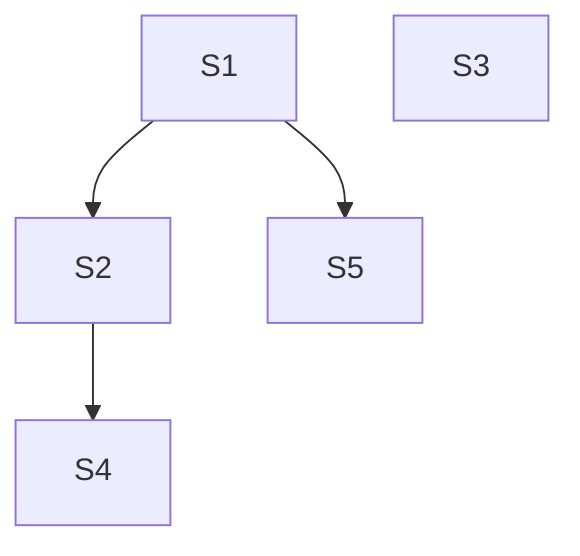

# Search at Scale Implementation Plan

> **For agentic workers:** REQUIRED SUB-SKILL: Use superpowers:subagent-driven-development (recommended) or superpowers:executing-plans to implement this plan task-by-task. Steps use checkbox (`- [ ]`) syntax for tracking.

**Goal:** Make contact search and listing index-backed on MySQL 8 at millions of rows, add a single `q` search across name, phone and email domain, switch to cursor paging, and move idempotency keys to Redis. The SPA gets one search box.

**Architecture:**
- **Indexes:** FULLTEXT `ngram` indexes on `contacts.name` and `contact_phones.phone`, plus the existing `contact_emails.domain` B-tree.
- **Search logic:** one Application-layer query builder (`ContactSearchQuery`) turns `q` and the explicit filters into indexed id subqueries, combined with `UNION` and `whereIn`.
- **Paging:** `cursorPaginate` ordered by `(name, id)`.
- **Test isolation:** tests in the Pest `fulltext` group commit their data and are truncated by the base `TestCase`.

**Tech Stack:** Laravel 13, PHP 8.5, MySQL 8.4 (Lerd), Pest 5; React 19, TypeScript, React Router 8, TanStack Query 5; Redis via phpredis.

**Spec:** `docs/superpowers/specs/2026-11-01-search-at-scale-design.md`

## Global Constraints

**Platform and dependencies**
- MySQL 8 only. MySQL-specific SQL is allowed. No new Composer or pnpm dependencies.
- FULLTEXT indexes use `WITH PARSER ngram`, created with `innodb_ft_enable_stopword = OFF` for the session. Keep `ngram_token_size` at its default of 2.

**Matching rules (exact)**
- **Name:** replace `+ - < > ( ) ~ * " @` with spaces, then collapse whitespace.
  - If any word has 2 or more characters, use `whereFullText('name', '"<cleaned>"', ['mode' => 'boolean'])`.
  - Otherwise, if not empty, use `name LIKE '<cleaned>%'`.
  - If empty, skip the filter.
- **Phone:** keep digits only, then drop one leading `0` if more than one digit remains.
  - With 2 or more digits, search them as a FULLTEXT boolean phrase on `contact_phones.phone`.
  - With fewer, skip the filter.
- **Domain, in `q` (prefix):** lowercase; strip a leading `@`; if the value contains `@`, take the part after the last `@`. Then `domain LIKE '<x>%'`, escaped with the existing `!` LIKE escape.
- **Domain, explicit `email_domain` filter:** exact match.

**`q` and filters**
- `q` is a `UNION` of the branches that apply, wrapped in `whereIn('contacts.id', …)`.
- If no branch applies, `q` is ignored.
- Explicit filters are ANDed together, each as `whereIn('contacts.id', <subquery>)`. No `whereHas`.

**Paging and validation**
- Paging: `cursorPaginate($perPage, cursor: …)` with `orderBy('name')->orderBy('id')`.
- `per_page`: default 25, maximum 100.
- Validation:
  - `q`: `nullable|string|max:255`;
  - `cursor`: `nullable|string|max:512`, plus a rule that decodes it;
  - `page` is removed.
- An invalid cursor gives 422 `validation_failed` on `cursor`.

**Process**
- Tests are colocated. No test imports or `uses()` a database trait. Full-text tests use `->group('fulltext')`.
- Guards are live: no Bash line or quoted string may start with npm, npx, yarn, a recursive rm or `migrate:fresh`. Use `pnpm`.
- Run each `git commit` as its own call, then confirm it with `git log --oneline -1`.
- Commit format: `git commit -m "REX-0001: <description>" -m "Co-Authored-By: Claude Opus 5.5 <noreply@anthropic.com>"`.
- Stage explicit paths. Never stage `README.md`, `.env`, `.lerd.yaml`, `.node-version`, `.php-version` or `.gitignore`.
- Review skills before each commit:
  - PHP: `review-solid`, `review-owasp-backend`, `review-db-performance`;
  - TS: `review-dry`, `review-solid`, `review-owasp-frontend`.

## Review Focus

1. **Operator-like search text** (`"jane`, `+jane -smith`, `*`, `@`, `()`) is treated as text. It never changes the meaning of the boolean query and never errors. [S1]
2. **Matching ignores case** ("JANE" finds "Jane"). Accents follow the MySQL collation ("jose" finds "José"); pin this with a test so the behaviour is documented. [S1]
3. **A cursor reused after `q` or the filters change** still returns a valid page, or a 422 if it's malformed. It never errors. [S2]
4. **The last page:** 40 contacts at `per_page=25` gives 25, then 15, with `next_cursor = null`. No contact is duplicated or skipped across the pages. [S2]
5. **The SPA:** changing `q` while on a cursor page drops the cursor. Browser Back returns to the previous page of results. [S4]

---

## Dependency Tree

| ID | Task | Depends on | Touches | Wave |
|---|---|---|---|---|
| S1 | FULLTEXT indexes, `fulltext` test isolation, `ContactSearchQuery` and its `EXPLAIN` tests | none | `database/migrations/*_add_search_indexes*`, `tests/TestCase.php`, `.claude/rules/testing.md`, `app/Modules/Contacts/Application/Search/**` | 1 |
| S3 | Idempotency keys in Redis | none | `.env.example`, `phpunit.xml` (cache store check only) | 1 |
| S5 | Bulk seeder: 10,000 contacts via batched inserts | S1 | `database/seeders/{BulkContactSeeder,BulkContactSeederTest,DatabaseSeeder,DatabaseSeederTest}.php`, `config/contacts.php` | 2 |
| S2 | Wire `q` and cursor paging through Action, validation, HTTP, CLI and OpenAPI | S1 | `Application/{Actions/SearchContacts*,DTOs/SearchContactsData*,Validation/{SearchContactsValidator*,Rules/ValidContactCursor*},Assemblers/SearchContactsDataFrom*}`, `Presentation/Http/{Controllers/ContactController*,openapi.json,OpenApiContractTest.php}`, `Presentation/Console/Commands/SearchContactsCommand*` | 2 |
| S4 | SPA: single search box, domain chip, cursor paging | S2 | `resources/js/lib/api/schema.d.ts`, `resources/js/modules/contacts/**` | 3 |

No two tasks in the same wave touch the same file. Sequential order: S1, S3, S5, S2, S4.

---

### Task S5: Bulk seeder (Rob's request: about 10,000 contacts, batched)

**Interfaces (Produces):**
- **`config/contacts.php`:** `'seed' => ['bulk_contacts' => (int) env('SEED_BULK_CONTACTS', 9960)]`. Combined with the 40 curated contacts, that makes 10,000.
- **`database/seeders/BulkContactSeeder.php`:**
  - `final class BulkContactSeeder extends Seeder`, with `public function run(?int $count = null): void`, where `$count` defaults to the config value.
  - **Determinism:**
    - `fake()->seed(20261101)`, and ids from `fake()->uuid()` lowercased, so a re-run produces the same rows;
    - `insertOrIgnore` everywhere, so seeding is idempotent and safe to repeat.
  - **Batching:**
    - build plain arrays in chunks of **1000 contacts**;
    - for each chunk, run one `insertOrIgnore` each into `contacts`, `contact_emails` and `contact_phones`;
    - set `created_at` and `updated_at` explicitly;
    - no per-row queries, and no model events.
  - **Data validity:**
    - **emails:** every email is built as a valid lowercase address, with `domain` computed exactly as `EmailAddress::fromString(...)->domain()` would compute it. Call it once per value to guarantee validity.
    - **phones:** every phone is valid E.164 for the existing patterns:
      - about 75% AU: mobile `+614` plus 8 digits, or landline `+61[2378]` plus 8 digits;
      - about 25% NZ: `+642` plus 7 or 8 digits, or a landline `+64[34679]` plus 7 digits.

      Check each one with `PhoneNumber::fromString`.
    - **counts per contact:** 1–3 emails and 1–2 phones, never duplicated within a contact.
    - **domains:** drawn from a fixed list of about 30 realistic AU and NZ domains plus some free-mail domains, so domain search returns useful groups.
    - **names:** Faker `en_AU` names.
- **`DatabaseSeeder`:** after the demo user and the curated `ContactSeeder`, call `BulkContactSeeder`.

**Steps:**
- [ ] **1. Write the failing tests.**
  - **`BulkContactSeederTest`**, using `(new BulkContactSeeder)->run(250)`:
    - exactly 250 contacts;
    - every phone passes `PhoneNumber::fromString`, and every email passes `EmailAddress::fromString` with a matching `domain`;
    - a second `run(250)` leaves the counts unchanged (idempotent);
    - with the query log enabled, the number of insert statements for 250 contacts is at most 3 per chunk of 1000. This proves batching: no per-row inserts.
  - **`DatabaseSeederTest`:** run it with config `contacts.seed.bulk_contacts = 100`. The result is 140 contacts (40 curated plus 100), and the counts are unchanged on a second run.
- [ ] **2. Run them and see them fail.**
- [ ] **3. Implement** the items listed under Interfaces.
- [ ] **4. Run them and see them pass.** Then, against the local database, run `php artisan db:seed --class=BulkContactSeeder` and report how long it took and the row counts: about 10,000 contacts, about 20,000 emails, about 15,000 phones. Then run `php artisan test --compact`.
- [ ] **5. Commit** with the message `REX-0001: bulk seeder for 10k contacts with batched inserts`.

---

### Task S1: Indexes, test isolation and the search query builder

**Interfaces (Produces):**
- **Migration** `database/migrations/2026_11_01_000010_add_search_indexes.php`:
  - `up()` runs the session `SET`, then `ALTER TABLE contacts ADD FULLTEXT INDEX contacts_name_fulltext (name) WITH PARSER ngram`, then the same for `contact_phones_phone_fulltext (phone)`, then restores the session setting;
  - `down()` drops both indexes.
- **`tests/TestCase.php`:** tests in the `fulltext` group skip the `RefreshDatabase` transaction. They truncate `contact_phones`, `contact_emails`, `contacts` and `users` before and after each test (disable FK checks around the truncation). Migrations still run once per process.
- **`.claude/rules/testing.md`:** add one bullet documenting the `fulltext` group exception and why: InnoDB only indexes FULLTEXT on commit.
- **`app/Modules/Contacts/Application/Search/SearchTerms.php`:** a `final class` with these static methods, each implementing the exact rule from Global Constraints:
  - `cleanName(string $raw): string`
  - `isFullTextName(string $cleaned): bool`
  - `phoneDigits(string $raw): ?string`
  - `domainPrefix(string $raw): ?string`
- **`app/Modules/Contacts/Application/Search/ContactSearchQuery.php`:**
  - `final class ContactSearchQuery`;
  - `public function apply(Builder $contacts, ?string $q, ?string $name, ?string $phone, ?string $emailDomain): Builder`, documented with `@param Builder<Contact>` and `@return Builder<Contact>`;
  - it builds each branch as an id subquery: name (FULLTEXT or prefix), phone (FULLTEXT `contact_id`), domain prefix or exact (`contact_id`);
  - `q` becomes a `UNION` of the applicable branches. Explicit filters each add a `whereIn`.

**Steps:**
- [ ] **1. Write the failing tests.**
  - **`SearchTermsTest`** (a pure unit test with datasets):
    - `cleanName`: `'mary-jane'` gives `'mary jane'`; `'"jane'` gives `'jane'`; `'+a -b*'` gives `'a b'`.
    - `isFullTextName`: `'a b'` is false, `'jo'` is true.
    - `phoneDigits`: `'0412 345 678'` gives `'412345678'`; `'+61 4'` gives `'614'`; `'5'` gives null; `'0'` gives null.
    - `domainPrefix`: `'@Rex.COM'` gives `'rex.com'`; `'jo@rex.com.au'` gives `'rex.com.au'`; `'@'` gives null.
  - **`ContactSearchQueryTest`** (`->group('fulltext')`; seed through factories or `UpsertContact`):
    - name substring: "mit" finds "Jane Smith"; "JANE" finds "Jane Smith";
    - "jose" finds "José Ortiz" (Review Focus 2);
    - one-character "j" finds by prefix;
    - phone "5678" finds `+61412345678`; "0412 345" finds it too;
    - `q` "rex" finds both "Rex Carter" and a contact with `@rex.com.au`, but not one with `@notrex.com.au`;
    - the explicit `email_domain` "rex.com" finds nothing (it's exact);
    - `name` "smi" combined with `email_domain` "rex.com.au" is an AND;
    - `q` of `"jane`, `+jane -smith`, `*` or `()` returns results without errors (Review Focus 1);
    - `q` "-" leaves the query unfiltered.
  - **`ContactSearchIndexTest`** (`->group('fulltext')`): `EXPLAIN` of the name branch subquery shows `key = contacts_name_fulltext` and `type = fulltext`; the phone branch the same with `contact_phones_phone_fulltext`; the domain-prefix branch shows `key = contact_emails_domain_index` and `type = range`. Get the SQL from the builder with `toRawSql()`, or by exposing the branch builders publicly for the test.
- [ ] **2. Run them and see them fail.** Run `php artisan test --compact app/Modules/Contacts/Application/Search`.
- [ ] **3. Implement** the migration, the `TestCase` change, the rule bullet, and `SearchTerms` and `ContactSearchQuery`. Run `php artisan migrate` on the dev database. It's additive, so it's safe; never use `migrate:fresh`.
- [ ] **4. Run them and see them pass.** Run the full suite with `php artisan test --compact`. Everything else must stay green, including the existing `SearchContacts` tests, which are still on the old code path at this point.
- [ ] **5. Commit** with the message `REX-0001: fulltext search indexes and indexed search query builder`.

---

### Task S3: Idempotency keys in Redis

**Steps:**
- [ ] **1. Check that phpredis is loaded** in Lerd's PHP: `php -m` lists `redis`. If it doesn't, STOP and report. Don't add `predis`.
- [ ] **2. Edit `.env.example`:** `CACHE_STORE=redis`, with `REDIS_CLIENT=phpredis`, `REDIS_HOST=127.0.0.1` and `REDIS_PORT=6379`. Make sure `phpunit.xml` keeps `CACHE_STORE=array`.
- [ ] **3. Run `php artisan test --compact`.** The idempotency tests stay green on the array store.
- [ ] **4. Commit** with the message `REX-0001: idempotency keys on redis cache store`.

(The controller points the local, uncommitted `.env` at Lerd's Redis separately.)

---

### Task S2: `q` and cursor paging end to end

**Interfaces:**
- **Consumes:** `ContactSearchQuery::apply` from S1.
- **Produces:**
  - **`SearchContactsData`:** `final readonly`, with `?string $q`, `?string $name`, `?string $phone`, `?string $emailDomain`, `int $perPage = 25` and `?string $cursor`. There is no `page`.
  - **`SearchContacts::handle(SearchContactsData $data): CursorPaginator`**, documented `@return CursorPaginator<int, Contact>`. It runs `Contact::query()->with(['emails', 'phones'])`, then `ContactSearchQuery::apply`, then `orderBy('name')->orderBy('id')->cursorPaginate($data->perPage, ['*'], 'cursor', Cursor::fromEncoded($data->cursor))`.
  - **`Rules/ValidContactCursor`:** a `ValidationRule`. It fails unless `Cursor::fromEncoded($value)` returns a cursor whose parameters are exactly `name` and `id`, both strings. Message: `The :attribute is not a valid page cursor.`
  - **`SearchContactsValidator` rules:**
    - `q`: `nullable|string|max:255`
    - `name`: as before
    - `phone`: as before (loose raw check), but normalisation moves to `SearchTerms`
    - `email_domain`: as before
    - `per_page`: as before
    - `cursor`: `nullable|string|max:512` plus `ValidContactCursor`
  - **Assemblers:** they map the request query `q` and `cursor`. On the CLI, the argument `q` and the options `--cursor` and `--per-page` are mapped.
  - **HTTP:** `ContactController@index` returns `ContactResource::collection($paginator)`, so Laravel emits a cursor `links` and `meta` (with `next_cursor`, `prev_cursor`, `per_page` and `path`).
  - **CLI:** `contacts:search {q?} {--name=} {--phone=} {--domain=} {--per-page=25} {--cursor=} {--json}`.
    - It prints the table, then `Next page: --cursor=<next>` when there is a next page.
    - `--json` prints `{"data": [...], "next_cursor": …, "prev_cursor": …}`.
  - **OpenAPI:**
    - the list operation adds `q` and `cursor` and removes `page`;
    - `ContactPage.meta` becomes `{path, per_page, next_cursor, prev_cursor}`, with the cursors typed as `["string", "null"]`;
    - `links` keeps `first`, `last`, `prev` and `next` (nullable, required) — check against Laravel's actual output;
    - add a 422 example for `cursor`.

**Steps:**
- [ ] **1. Write the failing tests** (the search ones in `->group('fulltext')`):
  - **`SearchContactsTest`:** update it for cursors.
    - Seed 40 contacts. Page with `perPage` 25: you get 25, then 15, then `nextCursor` is null.
    - The union of the ids across both pages is exactly 40, with no duplicates (Review Focus 4).
    - `q` works through the Action.
  - **`ValidContactCursorTest`:**
    - fails for `'garbage'`, for a base64 string of non-JSON, and for a cursor with an extra or array-typed parameter;
    - passes for a real `next_cursor` from a paginator.
  - **`ContactControllerTest`** (index):
    - `?q=rex` returns 200 with `meta.next_cursor` and no `meta.total`;
    - `?cursor=garbage` returns 422 `validation_failed` with an error on `cursor`;
    - a valid cursor from a `?q=smi` request reused with `?q=rex` returns 200, a valid page (Review Focus 3).
  - **`SearchContactsCommandTest`:**
    - `contacts:search smi` prints the match;
    - with more than 25 results it prints `Next page: --cursor=`;
    - `--json` includes `next_cursor`.
  - **`OpenApiContractTest`:** stays green after the document update.
- [ ] **2. Run them and see them fail.**
- [ ] **3. Implement** the items listed under Interfaces.
- [ ] **4. Run them and see them pass.** Run the full suite. Then `php artisan route:list --path=api/v1` should be unchanged.
- [ ] **5. Commit** with the message `REX-0001: q search and cursor paging across api and cli`.

---

### Task S4: SPA search box, domain chip and cursor paging

**Interfaces:**
- **Consumes:** the `openapi.json` from S2, regenerated with `pnpm run api:types`.
- **Produces:**
  - **`useContactSearchParams`:** handles `q`, `email_domain` and `cursor`.
    - `setQuery(q)` uses `replace` and drops `cursor`.
    - `setEmailDomain(domain | null)` drops `cursor`.
    - `goToCursor(cursor)` pushes a history entry.
    - `clear()`.
  - **`useContacts`** sends `q`, `email_domain`, `cursor` and `per_page`. The query key includes all of them.
  - **`ContactSearch`:**
    - a single input with the label and placeholder "Search by name, phone or email domain", debounced;
    - when `email_domain` is set, a removable chip `Domain: <x> ×`;
    - a Clear button;
    - a 422 on `q` or `cursor` shows under the input, using the field-error component.
  - **`ContactsListPage`:**
    - Previous and Next use `links.prev` / `links.next`, or `meta.prev_cursor` / `meta.next_cursor`, through `goToCursor`;
    - remove "Showing a–b of N", the header count, and the jump-to-last-page logic;
    - the header subtitle is "Search by name, phone or email domain";
    - the empty state is unchanged.
  - **Domain badge:** clicking a domain badge in a row calls `setEmailDomain`.

**Steps:**
- [ ] **1. Regenerate the types** with `pnpm run api:types`. The schema drift test must pass.
- [ ] **2. Write the failing tests:**
  - **`useContactSearchParams.test.ts`:**
    - `setQuery('smi')` on `?cursor=abc` gives `?q=smi`;
    - `goToCursor('x')` pushes a new history entry;
    - `setEmailDomain(null)` removes the chip parameter.
  - **`ContactsListPage.test.tsx`:**
    - typing "smi" commits `?q=smi` after the debounce, with no cursor;
    - Next navigates to `?q=smi&cursor=<next>`, and browser Back returns to `?q=smi` (Review Focus 5);
    - clicking a domain badge shows the chip, and removing the chip clears `email_domain`;
    - a 422 on `q` shows under the box;
    - no "Showing … of" text renders.
- [ ] **3. Run them and see them fail.**
- [ ] **4. Implement** the items listed under Interfaces. Update the existing tests that asserted the old three inputs or the totals.
- [ ] **5. Run them and see them pass,** then the full set: `pnpm test`, `pnpm run typecheck`, `pnpm run lint`, `pnpm run build`, `pnpm exec prettier --check resources/js`, and `php artisan test --compact`.
- [ ] **6. Commit** with the message `REX-0001: single search box and cursor paging in the spa`.
